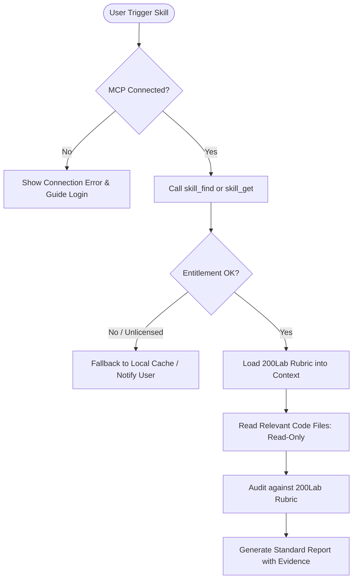

# 200Lab MCP Discovery & Protocol Specification

## 1. Overview
The **200Lab MCP Server** provides access to curated engineering rubrics, architectural guidelines, and AI tutoring directly from the 200Lab learning platform.

- **MCP Endpoint**: `https://mcp.200lab.io/mcp/learner`
- **Protocol**: Streamable HTTP / Server-Sent Events (SSE) JSON-RPC 2.0
- **Auth Scheme**: OAuth 2.0 PKCE (`https://api.200lab.io/oauth/authorize`, scope: `learner`)

---

## 2. Verified MCP Tools Catalog

| Tool Name | Parameters | Purpose | Expected Output |
| :--- | :--- | :--- | :--- |
| `skill_find` | `query: string, category?: string` | Searches 200Lab's skill catalog by domain keywords (e.g. "system-design", "reliability"). | Array of skill summaries matching the query. |
| `skill_get` | `skill_id: string` | Retrieves the complete rubric, criteria, and execution workflow for a 200Lab skill. | Markdown document with detailed evaluation standards. |
| `ai_tutor` | `question: string, context?: string` | Queries 200Lab's specialized AI tutor for architectural critiques and technical explanations. | Architectural advice and technical recommendations. |
| `ai_tutor_recommend` | `topic: string, current_stack?: string` | Recommends learning paths, engineering patterns, or migration strategies. | Curated syllabus & suggested architectural patterns. |
| `search` | `query: string` | Searches 200Lab's technical knowledge base, articles, and lessons. | Articles, code snippets, and documentation links. |
| `get` | `resource_id: string` | Retrieves full technical lesson content or guide. | Detailed technical guide text. |
| `get_artifact_download_url` | `artifact_id: string` | Generates a temporary secure URL to download architecture templates or sample code. | JSON object with `{ "download_url": "..." }`. |
| `learning_dashboard` | *(none)* | Inspects user's active courses, entitlements, and progress. | Active tracks and entitlement status. |

---

## 3. Tool Invocation Workflow

---

## 4. Fallback Strategy (When MCP is Unavailable)
1. **Explicit Notice**: State clearly: `[200Lab MCP Offline / Unreachable]`.
2. **Never Fabricate**: Do not pretend to call 200Lab if HTTP request fails or credentials are lost.
3. **Local Audit Option**: Inform the user: *"200Lab MCP server could not be reached. Would you like to proceed with local heuristic evaluation using cached offline rubrics?"*
4. **Tag Findings**: Prefix any offline finding with `[LOCAL-HEURISTIC]` instead of `[200LAB-VERIFIED]`.
