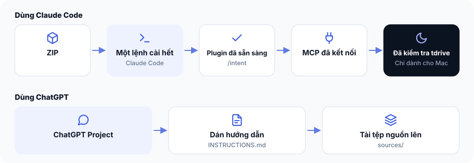

# Bài 3 — Cài đặt The Cookbook




**Bạn đang ở đâu:** Quyết định → Ý định → Công thức → Xây → Tự lái qua đêm → Ship. Bạn đang chuẩn bị công cụ để tiếp tục từ bản ý định đã duyệt.

Trang này tập trung toàn bộ hướng dẫn cài đặt The Cookbook. Bạn chỉ cần cài một lần, sau đó có thể quay lại đây khi muốn bật thêm tính năng, sửa lỗi hoặc cập nhật phiên bản mới.

Bản ZIP có một script cài đặt chung: `bash setup.sh`. Script sẽ:

- Cài plugin The Cookbook cho Claude Code.
- Thêm kết nối MCP `ard` để truy cập tài nguyên The Cookbook.
- Trên Mac, kiểm tra điều kiện và cài tdrive nếu máy đã sẵn sàng.
- Kiểm tra tab-pilot đã kết nối chưa.

Sau khi chạy, script in một báo cáo ngắn:

- **OK:** Đã hoàn tất.
- **TODO:** Việc bạn cần tự làm.
- **OPT:** Thành phần tùy chọn, có thể để sau.

Bạn không cần cài tất cả ngay. Mình khuyên bạn hoàn thành Claude Code và MCP trước, thử Intent Studio, rồi mới cài thêm những phần mình thực sự cần.

## Bạn cần gì?

| Thành phần | Dùng để làm gì | Bắt buộc? | Cần gì |
| --- | --- | --- | --- |
| Claude Code | Làm việc với Intent Studio, công thức và các công cụ xây ứng dụng. | Có, với cách làm trong Claude Code. | Claude Code đã cài và đăng nhập ([hướng dẫn cài Claude Code](https://docs.claude.com/en/docs/claude-code)). |
| Kết nối MCP (ard) | Cho Claude Code truy cập tài nguyên The Cookbook mà tài khoản bạn được phép sử dụng, bao gồm công thức mới nhất. | Có, nếu muốn đọc tài nguyên qua MCP. | setup.sh tự thêm kết nối. Bạn đăng nhập một lần bằng email mua The Cookbook. |
| tdrive | Điều khiển AgentKit hoặc Buildflow xây ứng dụng, kể cả qua đêm. | Không. | macOS, tmux, Claude Code đã đăng nhập và AgentKit có lệnh ak, hoặc Buildflow. |
| tab-pilot | Để Claude Code trao đổi với ChatGPT hoặc Gemini thay bạn, kiểm tra câu trả lời và lưu kết quả. | Không, phần nâng cao. | Máy Mac, Google Chrome, Node.js 18+, Claude Code và tài khoản Cloudflare miễn phí. |
| ChatGPT Project | Dùng Intent Studio trực tiếp trên ChatGPT. | Không. | Tài khoản ChatGPT và các file Project có sẵn trong ZIP. Nếu có tab-pilot, Claude có thể giúp tạo Project. |
| Claude web/Desktop connector | Đọc tài nguyên The Cookbook trong Claude trên trình duyệt hoặc Claude Desktop. | Không. | Thêm custom connector và đăng nhập bằng email mua The Cookbook. Kết nối này độc lập với Claude Code. |

**Nếu không có Mac hoặc chưa có AgentKit/Buildflow:** Bạn vẫn dùng được Intent Studio, các công thức và những phần còn lại phù hợp với máy của mình. Khi xây ứng dụng, bạn có thể làm từng bước với Claude Code, Cursor hoặc Codex mà không cần tdrive.

## Bước 1 — Cài bằng một yêu cầu

### Cách 1 — Nhờ AI làm

Đây là cách nhanh nhất nếu bạn đã dùng Claude Code.

Sau khi mua, bạn nhận email có liên kết tải bản ZIP The Cookbook. Tải ZIP về máy, mở Claude Code và dán nguyên đoạn sau:

```text
Mình muốn thiết lập The Cookbook trên máy này.

1. Tìm file the-cookbook-v*.zip có phiên bản mới nhất trong thư mục Downloads. Nếu không tìm thấy, hãy hỏi mình đường dẫn.
2. Giải nén vào ~/the-cookbook. Nếu thư mục này đã tồn tại, hỏi mình trước khi thay thế, đừng tự ghi đè.
3. Đọc file setup.sh trước khi chạy để hiểu script sẽ làm gì.
4. Vào thư mục vừa giải nén và chạy bash setup.sh.
5. Đọc báo cáo sau khi chạy và giải thích bằng tiếng Việt dễ hiểu:
   - OK: Những gì đã hoàn tất.
   - TODO: Những gì mình phải tự làm.
   - OPT: Những gì có thể để sau.
6. Hướng dẫn mình xử lý từng dòng TODO, mỗi lần một việc. Nếu cần đăng nhập, hãy chỉ mình thao tác.
7. Nhắc mình khởi động lại Claude Code sau khi hoàn tất.

Giữ nguyên thư mục ~/the-cookbook sau khi cài.

Chỉ thiết lập công cụ, chưa bắt đầu xây ứng dụng nào.
```

Claude Code sẽ đọc file, chạy script và hướng dẫn những bước cần tự thực hiện. Bạn vẫn cần cấp quyền cho các thao tác mà Claude Code yêu cầu.

**Lưu ý:** Nếu script báo TODO, nghĩa là bạn còn một việc cần hoàn thành. Đừng bỏ qua những dòng này nếu chúng liên quan đến thành phần bạn muốn sử dụng.

### Cách 2 — Tự làm từng bước

Nếu thích tự kiểm soát từng thao tác, bạn có thể tự chạy script.

**1. Giải nén The Cookbook**

Giải nén ZIP vào một thư mục cố định, chẳng hạn `~/the-cookbook`.

Đừng di chuyển hoặc xóa thư mục sau khi cài. Claude Code cần đọc plugin từ vị trí này.

**2. Mở Terminal**

Terminal là cửa sổ để nhập lệnh điều khiển máy tính.

Đi đến thư mục vừa giải nén:

```bash
cd ~/the-cookbook
```

Nếu muốn xem trước script sẽ làm gì mà chưa thay đổi máy, chạy:

```bash
bash setup.sh --dry-run
```

Khi đã sẵn sàng, chạy:

```bash
bash setup.sh
```

**3. Đọc báo cáo**

Script sẽ tự xử lý những phần có thể cài tự động và in báo cáo OK, TODO, OPT.

Bạn chỉ cần làm tiếp những dòng TODO liên quan đến thành phần mình sử dụng. Sau khi sửa một điều kiện còn thiếu, có thể chạy lại `bash setup.sh`.

Script được thiết kế để chạy lại an toàn, nên bạn không cần bắt đầu mọi thứ từ đầu.

**4. Khởi động lại Claude Code**

Sau khi hoàn thành cài đặt, đóng phiên Claude Code đang mở rồi khởi động lại để nhận plugin và các kết nối mới.

## Bước 2 — Đăng nhập MCP

`setup.sh` đã thêm kết nối `ard` vào Claude Code. Bạn không cần tự chạy lệnh thêm MCP.

MCP giúp Claude đọc tài nguyên The Cookbook mà tài khoản của bạn được phép truy cập.

### Với Claude Code

1. Mở Claude Code.
2. Gõ `/mcp`.
3. Chọn kết nối `ard`.
4. Chọn **Authenticate**.
5. Đăng nhập bằng đúng email bạn đã dùng mua The Cookbook.
6. Hoàn tất xác thực, rồi khởi động lại Claude Code.

Sau đó, thử yêu cầu:

```text
Hãy tìm và đọc công thức mới nhất về đặt lịch trong The Cookbook.
```

Nếu Claude đọc được tài liệu, kết nối đã sẵn sàng.

### Với Claude web hoặc Claude Desktop (tùy chọn)

Đây là một kết nối riêng. Việc cài MCP trong Claude Code không tự động kết nối Claude trên trình duyệt hoặc Claude Desktop.

Nếu muốn sử dụng ở đó:

1. Mở **Settings → Connectors → Add custom connector**.
2. Nhập địa chỉ:
`https://mcp.arealisticdreamer.com/mcp`
3. Hoàn tất đăng nhập bằng email mua The Cookbook.
4. Mở một cuộc trò chuyện và yêu cầu Claude đọc một công thức mà tài khoản của bạn có quyền truy cập.

Bạn không cần cài connector này nếu chỉ làm việc trong Claude Code.

## Bước 3 — tdrive (nếu dùng Mac và có AgentKit hoặc Buildflow)

tdrive là công cụ giúp Claude Code điều khiển quá trình xây ứng dụng bằng AgentKit hoặc Buildflow, kể cả qua đêm.

Để chạy được tdrive, bạn cần:

- Máy chạy **macOS**.
- Có **tmux**, công cụ duy trì phiên làm việc trong Terminal.
- Claude Code đã đăng nhập.
- Có một trong hai công cụ xây dựng:

  - [AgentKit](https://go.arealisticdreamer.com/agentkit), với lệnh `ak` hoạt động.
  - [Buildflow](https://arealisticdreamer.com/ship-with-claude), có trong khóa Ship with Claude.

### tdrive đã được cài chưa?

Bạn không cần chạy một quy trình cài tdrive riêng từ đầu.

Khi chạy `bash setup.sh` trên Mac, script sẽ kiểm tra các điều kiện cần thiết. Nếu máy đã sẵn sàng, script tự cài tdrive.

Nếu chưa đủ điều kiện, báo cáo sẽ có dòng dạng:

```text
tdrive needs: ...
fix: ...
```

Dòng `tdrive needs:` cho biết máy đang thiếu gì. Dòng `fix:` là hướng dẫn sửa từ bước kiểm tra preflight của tdrive.

Bạn làm theo hướng dẫn `fix:`, sau đó quay lại thư mục The Cookbook và chạy:

```bash
bash setup.sh
```

Script sẽ kiểm tra lại.

Nếu việc cài tdrive bị dừng và bạn cần cài lại phần này, xem cách xử lý trong bảng **Bị kẹt?** bên dưới.

### Nếu chưa đủ điều kiện

Bạn có thể bỏ qua tdrive.

Intent Studio, các công thức và cách xây ứng dụng từng bước vẫn hoạt động. Bạn không cần mua AgentKit hoặc Buildflow chỉ để bắt đầu dùng những phần đó.

### Sau khi cài tdrive

Phần này chỉ giúp bạn cài đặt và kiểm tra điều kiện. Cách chuẩn bị công việc, duyệt phạm vi và bắt đầu chạy được hướng dẫn trong [Bài 8: Để tdrive chạy việc xây dựng qua đêm](08-tdrive-qua-dem.md).

Bạn chưa cần bắt đầu một phiên xây dựng ngay sau khi cài.

## Bước 4 — tab-pilot (tùy chọn, nâng cao)

### tab-pilot là gì?

Bạn đang xây app bằng Claude Code, nhưng tới những chuyện như mô hình kinh doanh, định giá, đối thủ hay viết nội dung, bạn muốn có thêm góc nhìn từ ChatGPT.

**tab-pilot giúp Claude tự trao đổi với ChatGPT thay bạn, theo những quy tắc rõ ràng.**

Claude chuẩn bị đề bài, gửi ChatGPT, kiểm tra câu trả lời và phản biện nếu cần, tối đa khoảng 3 vòng.

Sau đó Claude mang kết quả về, nói rõ đã kiểm tra và sửa những gì, còn điều gì chưa chắc chắn. Kết quả được lưu trong `brainstorm/…` hoặc `content/…`, kèm liên kết cuộc trò chuyện.

Bạn vẫn làm việc trong Claude Code, không phải copy-paste qua lại. Bạn cũng có thể yêu cầu Claude trao đổi với Gemini.

### Trước khi bắt đầu

Bạn cần chuẩn bị:

- **Máy Mac** có cài Google Chrome.
- **Node.js phiên bản 18 trở lên.** Nếu chưa có, tải bản LTS tại [https://nodejs.org](https://nodejs.org).
- **Claude Code đã cài đặt.** Nếu chưa chắc, hãy hoàn thành Bước 1.
- **Một tài khoản Cloudflare miễn phí.** Nếu chưa có, đăng ký tại [https://dash.cloudflare.com/sign-up](https://dash.cloudflare.com/sign-up) và xác nhận email.
- **Khoảng 10 phút** để cài đặt.

tab-pilot dùng một kết nối riêng, gọi là relay, chạy trên tài khoản Cloudflare của bạn.

Bạn không cần biết lập trình hay tự cấu hình Cloudflare. Mình đã chuẩn bị script `setup-tab-pilot.sh` trong thư mục The Cookbook để giúp bạn làm những việc đó.

Script sẽ kiểm tra máy, tạo kết nối, hướng dẫn cài Chrome extension và kết nối Claude Code.

**Có hai cách cài.** Cách 1 dành cho bạn muốn nhờ Claude Code hướng dẫn. Cách 2 là tự chạy script trong Terminal. Cả hai dùng cùng một script.

### Cách 1 — Nhờ AI làm

Mở Claude Code và gửi nguyên đoạn này:

```text
Mình muốn cài tab-pilot trong The Cookbook.

Hãy vào thư mục ~/the-cookbook, đọc file
setup-tab-pilot.sh để hiểu cách cài đặt.

Sau đó giúp mình chạy:

bash setup-tab-pilot.sh

Mình cần nhìn thấy quá trình chạy và có thể trả lời
các câu hỏi của script, bao gồm nhấn Enter và
thao tác trong Chrome.

Nếu bạn không thể chạy script tương tác theo cách
đó, hãy hướng dẫn mình mở Terminal và tự chạy.
Đừng tự chạy ngầm rồi bỏ qua các bước cần mình làm.

Nếu script dừng ở dòng STOP:, hãy giải thích
bằng tiếng Việt dễ hiểu:
- Đang thiếu hoặc sai điều gì?
- Mình cần làm gì để sửa?
- Sau đó chạy lại lệnh nào?

Không bật "Allow publishing" ở bất kỳ bước nào.
Không hiển thị hoặc đưa token vào câu trả lời.

Hướng dẫn mình tới khi script báo Done,
kiểm tra kết nối thành công và có thể dùng
ChatGPT từ Claude Code.
```

Claude sẽ đọc script và hướng dẫn bạn.

Có một điều cần lưu ý: trong lúc cài, script sẽ yêu cầu bạn đăng nhập Cloudflare, thao tác trong Chrome và nhấn Enter để tiếp tục.

Nếu Claude không thể chạy một chương trình cần tương tác trực tiếp, bạn sẽ phải tự mở Terminal.

Điều này bình thường. Bạn cứ làm theo Cách 2 bên dưới, không cần cài lại từ đầu.

### Cách 2 — Tự làm từng bước

**1. Mở Terminal và chạy script**

Trên Mac, mở Terminal.

Đi tới thư mục The Cookbook:

```bash
cd ~/the-cookbook
```

Nếu đã giải nén ở thư mục khác, hãy thay `~/the-cookbook` bằng đường dẫn thực tế.

Chạy:

```bash
bash setup-tab-pilot.sh
```

Từ đây, script sẽ lần lượt làm 7 việc. Bạn đọc hướng dẫn trên Terminal và chỉ thao tác khi được yêu cầu.

Nếu gặp dòng bắt đầu bằng `STOP:`, nghĩa là script đang dừng để bạn sửa một vấn đề.

Hãy xem bảng **Bị kẹt?** bên dưới, sửa xong rồi chạy lại:

```bash
bash setup-tab-pilot.sh
```

Script có thể chạy lại nhiều lần. Những phần đã hoàn tất sẽ được bỏ qua.

**2. Kiểm tra phần mềm trên máy**

Script kiểm tra:

- Google Chrome.
- Node.js 18 trở lên.
- Claude Code.

Nếu thiếu Chrome, bạn cần cài Chrome.

Nếu thiếu Node.js hoặc phiên bản quá cũ, tải bản LTS tại [https://nodejs.org](https://nodejs.org).

Nếu thiếu Claude Code, cài theo [hướng dẫn Claude Code](https://docs.claude.com/en/docs/claude-code), rồi chạy `bash setup.sh` trong thư mục The Cookbook.

Sau khi sửa, chạy lại `bash setup-tab-pilot.sh`.

**3. Đăng nhập Cloudflare**

Nếu máy chưa đăng nhập Cloudflare, script sẽ mở trình duyệt để bạn đăng nhập.

Bạn làm theo các bước:

1. Đăng nhập tài khoản Cloudflare.
2. Nếu Cloudflare hỏi quyền truy cập, nhấn **Allow**.
3. Quay lại Terminal và tiếp tục theo hướng dẫn.

Nếu chưa có tài khoản, vào [https://dash.cloudflare.com/sign-up](https://dash.cloudflare.com/sign-up), tạo tài khoản miễn phí và xác nhận email trước. Sau đó chạy lại script.

Nếu bạn có nhiều tài khoản Cloudflare, script có thể yêu cầu nhập **Account ID**. Hãy lấy Account ID của tài khoản bạn muốn sử dụng và dán vào Terminal.

Đây là bước cấp quyền để script thiết lập kết nối trên tài khoản của bạn.

**4. Tạo relay riêng**

Script sẽ đưa relay lên Cloudflare của bạn.

Relay là phần giúp Claude Code và Chrome extension trao đổi với nhau. Bạn không cần tự triển khai hay viết code.

Nếu Cloudflare yêu cầu thiết lập địa chỉ `workers.dev`, bạn làm theo hướng dẫn:

1. Mở [https://dash.cloudflare.com](https://dash.cloudflare.com).
2. Vào **Workers & Pages**.
3. Chọn một tên subdomain bất kỳ để tạo địa chỉ `workers.dev`.
4. Chờ khoảng 1 phút.
5. Quay lại Terminal và chạy lại script.

Với một số tài khoản Cloudflare mới, dịch vụ lưu trữ R2 chưa được bật.

tab-pilot vẫn hoạt động mà không có R2. Chỉ tính năng tải lên các file lớn là chưa dùng được, và The Cookbook không cần tính năng đó.

**5. Tạo token riêng**

Script sẽ tự tạo một token để bảo vệ kết nối.

Token được lưu trong:

```text
tab-pilot/.env
```

Bạn không cần tự tạo hay gửi token cho ai.

**Quan trọng:** Token này giống như mật khẩu. Ai có token có thể điều khiển Chrome đang đăng nhập của bạn thông qua tab-pilot.

Đừng gửi file `.env`, chụp màn hình có token hoặc dán token vào Discord.

Nếu nghi ngờ token bị lộ, mở Terminal trong thư mục The Cookbook và chạy:

```bash
bash setup-tab-pilot.sh --new-token
```

Sau đó mở phần cài đặt Chrome extension, dán token mới vào ô **Token**, nhấn **Save & connect** và chạy lại:

```bash
bash setup-tab-pilot.sh
```

Script sẽ cập nhật kết nối cho Claude Code.

**6. Cài Chrome extension**

Đây là phần bạn cần thao tác bằng tay.

Script sẽ mở sẵn:

- Chrome tại `chrome://extensions`.
- Finder tại thư mục `tab-pilot/extension`.

Trong Chrome:

1. Bật **Developer mode** (Chế độ dành cho nhà phát triển).
2. Nhấn **Load unpacked** (Tải tiện ích đã giải nén).
3. Chọn đúng thư mục `tab-pilot/extension` mà Finder đang mở.
4. Sau khi extension xuất hiện, mở thẻ **tab-pilot**.
5. Nhấn **Details** (Chi tiết).
6. Chọn **Extension options** (Tùy chọn tiện ích).

Giữ trang tùy chọn này mở.

Quay lại Terminal. Script sẽ lần lượt hướng dẫn bạn nhập hai giá trị.

**Đầu tiên là Relay URL:**

- Script đã chép Relay URL vào clipboard.
- Dán vào ô **Relay URL** trong Extension options.
- Quay lại Terminal, nhấn **Enter** để tiếp tục.

**Tiếp theo là Token:**

- Script sẽ chép token vào clipboard.
- Dán vào ô **Token** trong Extension options.
- Nhấn **Save & connect**.
- Quay lại Terminal, nhấn **Enter**.

Script sẽ kiểm tra và chờ extension kết nối.

Nếu chưa kết nối được, kiểm tra lại Relay URL, Token và nút Save & connect. Bạn không cần xóa extension hay tạo lại relay.

**Lưu ý về quyền:** Khi cài đặt, cứ để **Allow publishing** ở trạng thái **OFF**. Claude bàn với ChatGPT không cần quyền này. Chỉ bật khi bạn muốn Claude đăng bài (xem phần "Đăng bài và cross-post" bên dưới), rồi tắt lại sau khi đăng xong.

**7. Kết nối Claude Code và ChatGPT**

Sau khi extension kết nối, script tự cấu hình tab-pilot cho Claude Code.

Tiếp đó, script kiểm tra bạn đã đăng nhập ChatGPT trong Chrome hay chưa.

Nếu Terminal yêu cầu đăng nhập:

1. Mở [https://chatgpt.com](https://chatgpt.com) trong Chrome.
2. Đăng nhập tài khoản ChatGPT.
3. Đảm bảo bạn dùng **đúng Chrome profile đã cài tab-pilot**.
4. Quay lại Terminal và làm theo hướng dẫn.

Khi hoàn tất, script sẽ báo:

```text
Done.
```

**Cuối cùng, hãy tắt phiên Claude Code đang mở rồi khởi động lại Claude Code.**

Việc khởi động lại giúp Claude nhận kết nối mới.

**Trong lúc sử dụng tab-pilot:**

- Giữ Chrome đang mở.
- Máy Mac cần đang thức, không ở chế độ ngủ.
- Những tab Claude dùng để làm việc sẽ nằm trong một nhóm tab màu xám có tên `tab-pilot`.
- Các tab này tự đóng sau 5 phút không hoạt động.
- Đừng thu gọn nhóm tab `tab-pilot`. Chrome có thể tạm dừng các tab trong nhóm bị thu gọn. Nếu lỡ thu gọn, extension sẽ mở nhóm lại.

Nếu cần cài thủ công từng thành phần mà không dùng script, tài liệu dành cho người đã quen kỹ thuật nằm ở `tab-pilot/README.md`.

### Thử ngay

Trong Claude Code, cứ nói bằng ngôn ngữ tự nhiên:

```text
Bàn với ChatGPT: app đặt lịch tiệm tóc nên bán theo tháng hay một lần? Đừng bịa số liệu.
```

```text
Nhờ ChatGPT viết 3 câu mở đầu bài Facebook giới thiệu app, giọng thân thiện.
```

```text
Hỏi Gemini về giá của các đối thủ.
```

Claude sẽ chuẩn bị đề bài, trao đổi và kiểm tra câu trả lời, yêu cầu sửa nếu cần, rồi lưu kết quả kèm liên kết cuộc trò chuyện để bạn xem lại.

Bạn không cần tự chuyển nội dung giữa Claude Code và ChatGPT.

### Đăng bài và cross-post (tùy chọn)

Ngoài việc nhờ Claude bàn với ChatGPT hoặc Gemini, tab-pilot còn giúp Claude đăng và quản lý nội dung trên chính các tài khoản của bạn.

Bạn chỉ cần nói bằng lời bình thường. Claude chuẩn bị bản nháp, cho bạn xem và chờ bạn đồng ý trước khi đăng.

#### Các nền tảng đang hỗ trợ

| Nền tảng | Làm được gì |
| --- | --- |
| LinkedIn | Đăng bài feed kèm ảnh/video, viết article, bình luận, đọc feed, tìm kiếm, xem thống kê 7 ngày. |
| Substack | Tạo bản nháp, xem trước bài hiển thị ra sao, xuất bản bài, đăng Notes, tải ảnh, xem thống kê. Có thể gửi email tới người đăng ký nhưng phải được bạn đồng ý riêng, mặc định không gửi. |
| Viblo | Tạo nháp, xuất bản, lên lịch đăng bằng tính năng của Viblo, bình luận, đặt ảnh bìa, tìm bài nổi bật theo tag hoặc từ khóa để tham khảo. |
| dev.to | Tạo nháp, xuất bản, lên lịch đăng bằng tính năng của dev.to, bình luận. Cần kết nối một lần. |
| TikTok | Tải video kèm caption, xem thống kê video và bình luận. |

Bạn cũng có thể nhờ Claude cross-post một bài viết dài: chuẩn bị bài Substack, nhờ ChatGPT viết một LinkedIn article ngắn hơn, thêm bài thông báo và bình luận dẫn link về Substack.

Claude tạo các bản nháp trước để bạn duyệt, rồi mới xuất bản các phần đã được duyệt trong cùng một quy trình. Nếu một bước lỗi, quy trình có thể tiếp tục từ phần còn dang dở.

#### Trước khi đăng bài đầu tiên

1. Mở Chrome trên máy Mac và đăng nhập vào nền tảng bạn muốn sử dụng bằng tài khoản của chính mình.
2. Đảm bảo đó là cùng Chrome đang cài tab-pilot.
3. Sau khi chạy `bash setup-tab-pilot.sh`, xem danh sách nền tảng ở cuối báo cáo:

  - `OK`: Đã đăng nhập.
  - `OPT`: Chưa đăng nhập, cần mở trang đó và đăng nhập nếu muốn sử dụng.
4. Riêng dev.to, nói với Claude: "kết nối dev.to" để kết nối một lần.

Bạn chỉ cần đăng nhập vào những nền tảng mình định dùng.

#### Claude đăng bài như thế nào?

Quy trình đăng bài có hai lớp xác nhận:

1. Chuẩn bị: Claude tạo bản nháp và cho bạn xem nội dung.
2. Bạn duyệt: Bạn kiểm tra, yêu cầu sửa nếu cần, rồi đồng ý đăng ngay trong cuộc trò chuyện.
3. Cho phép xuất bản: Vào phần Options của extension, bật Allow publishing. Tùy chọn này mặc định tắt.
4. Đăng và kiểm tra: Claude thực hiện thao tác, đọc lại kết quả trên trang để xác minh, rồi gửi link cho bạn.
5. Sau khi xong: Tắt lại Allow publishing nếu không còn đăng bài.

Việc bạn đồng ý đăng một bài chỉ có hiệu lực với bài đó. Claude không được lấy lần đồng ý ấy để tự đăng những bài khác.

Với Substack, việc gửi email đến người đăng ký là một quyết định riêng. Mặc định không gửi email, kể cả khi bạn đã đồng ý xuất bản bài viết.

#### Thử ngay

Bạn có thể nói với Claude Code:

```text
Đăng bài này lên LinkedIn.

Cross-post bài này sang Substack và LinkedIn.

Lên lịch bài Viblo 8 giờ sáng mai.

Up video này lên TikTok.

Xem thống kê LinkedIn tuần này.
```

Claude sẽ xử lý theo khả năng của từng nền tảng. Những thao tác công khai vẫn cần bạn duyệt trước.

Với video dung lượng lớn: Claude tự tải file lên relay riêng của bạn trước, rồi thực hiện bước upload lên nền tảng. Bạn không cần tự chuyển file qua relay.

#### Nếu một bước bị lỗi

Các nền tảng thỉnh thoảng thay đổi giao diện, nên có lúc tab-pilot không tìm được thành phần cần thao tác.

Khi gặp trường hợp này:

1. Claude dừng tại bước bị lỗi, báo rõ nền tảng nào và thao tác nào chưa hoàn tất.
2. Bạn đăng hoặc thực hiện bước đó thủ công lần này.
3. Báo lỗi trong Discord `#cookbook` để bộ kit được sửa trong các bản cập nhật.

tab-pilot thao tác trên tài khoản thật của bạn. Vì vậy, bạn vẫn chịu trách nhiệm về nội dung được xuất bản. Mình khuyên bạn dùng nó theo thói quen đăng bài bình thường của mình, kiểm tra kỹ nội dung trước khi duyệt và tắt quyền xuất bản khi không cần.

## Bước 5 — ChatGPT Project (tùy chọn)

Intent Studio đã hoạt động trực tiếp trong Claude Code, nên bạn không bắt buộc phải tạo ChatGPT Project.

Nếu muốn làm việc với Intent Studio ngay trên ChatGPT, bạn có hai cách.

### Nếu đã cài tab-pilot

Trong Claude Code, nói:

```text
tạo Intent Studio trên ChatGPT cho mình
```

Claude sẽ tự tạo ChatGPT Project, bao gồm instructions và source files.

Bạn không cần tự sao chép hay tải từng file lên.

### Nếu chưa cài tab-pilot

Bạn có thể tạo Project thủ công:

1. Tạo một Project mới trong ChatGPT.
2. Mở `intent-studio/chatgpt-project/INSTRUCTIONS.md` trong thư mục The Cookbook.
3. Sao chép nội dung file này vào phần hướng dẫn của Project.
4. Tải các file trong `intent-studio/chatgpt-project/sources/` lên Project.
5. Bắt đầu cuộc trò chuyện trong Project và yêu cầu chạy Intent Studio.

Nếu chưa muốn làm bước này, bạn có thể bỏ qua và tiếp tục sử dụng Intent Studio trong Claude Code.

## Kiểm tra đã xong

Bạn có thể tự kiểm tra những thành phần đã cài bằng danh sách sau:

- **Plugin:** Báo cáo `setup.sh` hiển thị OK cho phần cài plugin The Cookbook.
- **Intent Studio:** Sau khi khởi động lại Claude Code, thử nói: `Biến ý tưởng này thành bản ý định: <ý tưởng>`. Thay `<ý tưởng>` bằng ý tưởng của bạn. Nếu Claude bắt đầu hướng dẫn phát triển bản ý định, phần này đã hoạt động.
- **MCP:** Trong Claude Code, `/mcp` có kết nối `ard`, bạn đã Authenticate bằng email mua hàng và Claude đọc được một công thức The Cookbook.
- **tdrive (nếu dùng):** Báo cáo cài đặt cho biết tdrive đã sẵn sàng, các điều kiện preflight đã đạt. Cách chạy thực tế nằm ở Bài 8.
- **tab-pilot (nếu dùng):** Script báo `Done.`. Trong Terminal, từ thư mục The Cookbook, chạy:
```bash
./tab-pilot/tp status
```
Kết quả cần có:
```json
"connected":true
```
Sau đó khởi động lại Claude Code và thử:
```text
Bàn với ChatGPT: App đặt lịch tiệm tóc cần quyết định những gì trước khi bắt đầu build? Hãy liệt kê ngắn gọn.
```
Nếu Claude nhận được câu trả lời từ ChatGPT và lưu kết quả vào file kèm liên kết cuộc trò chuyện, tab-pilot đã hoạt động.

Bạn không cần đánh dấu hết tất cả các ô. Những thành phần tùy chọn có thể làm sau.

## Bị kẹt?

Nếu gặp lỗi, tìm hiện tượng tương ứng trong bảng sau.

Với các lỗi bắt đầu bằng `STOP:`, script đang dừng để bạn sửa vấn đề. Làm theo hướng dẫn rồi chạy lại script tương ứng.

| Hiện tượng | Cách xử lý |
| --- | --- |
| Cài plugin thất bại | Xem log tại /tmp/cookbook-install.log để biết lỗi, sau đó chạy lại bash setup.sh từ thư mục The Cookbook. |
| MCP không mở trang đăng nhập hoặc không đọc được recipe | Mở Claude Code, gõ /mcp, chọn ard → Authenticate. Đăng nhập bằng đúng email đã mua The Cookbook, sau đó khởi động lại Claude Code và thử đọc recipe. |
| Báo tdrive needs: ... | Đọc dòng fix: đi kèm, sửa điều kiện còn thiếu rồi chạy lại bash setup.sh. Nếu chưa có Mac, AgentKit hoặc Buildflow, bạn có thể bỏ qua tdrive và xây từng bước. |
| tdrive install stopped | Trong thư mục The Cookbook, chạy lại bash tdrive-beta/install.sh --force. Script sẽ sao lưu trước khi cài lại. |
| Chạy sai thư mục hoặc đã di chuyển The Cookbook | Nên giữ thư mục ~/the-cookbook sau khi cài. Nếu đã chuyển sang nơi khác, mở Terminal tại thư mục mới và chạy lại bash setup.sh để cập nhật cài đặt. |
| STOP: Node.js is not installed hoặc too old | Tải và cài Node.js bản LTS tại https://nodejs.org. Sau đó chạy lại bash setup-tab-pilot.sh. |
| STOP: Google Chrome is not installed | Cài Google Chrome trên Mac rồi chạy lại bash setup-tab-pilot.sh. |
| STOP: Claude Code is not installed | Cài Claude Code trước theo https://docs.claude.com/en/docs/claude-code, chạy bash setup.sh trong thư mục The Cookbook, rồi chạy lại script tab-pilot. |
| Trang đăng nhập Cloudflare không mở hoặc báo Cloudflare login did not finish | Vào https://dash.cloudflare.com, tạo tài khoản nếu chưa có và xác nhận email. Chạy lại script, đăng nhập và nhớ nhấn Allow khi Cloudflare hỏi quyền. |
| no workers.dev address yet | Mở https://dash.cloudflare.com → Workers & Pages, chọn một tên subdomain bất kỳ, chờ khoảng 1 phút rồi chạy lại script. |
| Deploying the relay failed | Chạy lại bash setup-tab-pilot.sh thêm một lần. Nếu vẫn lỗi, sao chép các dòng thông báo ngay phía trên STOP: và gửi vào Discord #cookbook. Không gửi token hay nội dung file .env. |
| The extension did not connect | Mở chrome://extensions → tab-pilot → Details → Extension options. Kiểm tra Relay URL có đúng không, Token không có khoảng trắng thừa. Nhấn Save & connect, giữ Chrome mở và chạy lại script. |
| TODO: open chatgpt.com ... log in | Mở https://chatgpt.com và đăng nhập trong đúng Chrome profile đã cài tab-pilot. Sau đó chạy lại script nếu cần. |
| Claude báo ChatGPT not connected dù đã cài xong | Thoát và khởi động lại Claude Code. Trong Terminal chạy ./tab-pilot/tp status để kiểm tra kết nối. Nếu chưa thấy "connected":true, kiểm tra lại extension như hướng dẫn ở trên. |
| ChatGPT trả lời chậm hoặc bị timeout | Những câu trả lời dài có thể mất nhiều thời gian. Claude có thể chờ trong nền. Giữ Chrome mở, máy Mac không ngủ và đừng thu gọn nhóm tab tab-pilot. |
| Chuyển sang Mac mới hoặc Chrome mới | Chạy lại bash setup-tab-pilot.sh trong thư mục The Cookbook. Script sẽ sử dụng lại relay (và token, nếu bạn chép cả thư mục cũ), đồng thời hướng dẫn kết nối Chrome mới. |
| Không đăng được vì Allow publishing đang tắt | Mở Options của extension, bật Allow publishing, rồi thử lại sau khi đã duyệt bản nháp. Tắt lại khi đăng xong. |
| Nền tảng hiện chưa đăng nhập (OPT) | Mở nền tảng đó trong cùng Chrome đang dùng tab-pilot, đăng nhập tài khoản của bạn rồi kiểm tra lại. |
| Claude báo lỗi ở một bước sau khi nền tảng đổi giao diện | Xem Claude báo lỗi ở nền tảng và bước nào, thực hiện thủ công lần này, rồi báo trong Discord #cookbook để được sửa trong bản cập nhật. |
| dev.to báo chưa kết nối | Nói với Claude "kết nối dev.to" để thiết lập kết nối một lần, sau đó thử lại. |
| Vẫn bị kẹt sau khi thử cách trên | Gửi dòng STOP: cùng các thông báo lỗi liên quan vào Discord #cookbook. Không gửi token, file .env hoặc thông tin đăng nhập. |

Nếu không biết bắt đầu sửa từ đâu, bạn có thể mở Claude Code và dán:

```text
Mình đang thiết lập The Cookbook nhưng có bước chưa xong.

Hãy vào thư mục ~/the-cookbook, chạy lại bash setup.sh và đọc báo cáo.

Giải thích từng dòng TODO bằng tiếng Việt dễ hiểu. Chỉ giúp mình sửa đúng những gì báo cáo liệt kê, mỗi lần một việc. Đừng cài thêm những thứ không cần thiết và chưa bắt đầu build ứng dụng.
```

Nếu lỗi nằm ở tab-pilot, hãy yêu cầu Claude đọc `setup-tab-pilot.sh` và giải thích dòng `STOP:` tương ứng, thay vì chạy lại toàn bộ quá trình cài đặt.

Nếu chưa cài được tab-pilot, bạn vẫn dùng được The Cookbook. Claude có thể tự brainstorm hoặc chuẩn bị sẵn đề bài để bạn dán vào ChatGPT.

Nếu chưa cài được tdrive, bạn vẫn có thể xây ứng dụng từng bước.

**Nếu đã thử những cách trên mà vẫn kẹt, hãy hỏi trong Discord #cookbook.** Gửi thông báo lỗi và mô tả bước đang làm, nhưng tuyệt đối không gửi token, file `.env`, mật khẩu hay thông tin đăng nhập.

## Cập nhật

Khi The Cookbook có bản mới, bạn không cần thực hiện lại toàn bộ các bước cài đặt bằng tay.

1. Mở [https://arealisticdreamer.com/members](https://arealisticdreamer.com/members).
2. Đăng nhập bằng email đã dùng mua The Cookbook.
3. Tải bản ZIP mới nhất.
4. Giải nén vào `~/the-cookbook` hoặc một thư mục mới. Nếu giải nén đè lên thư mục cũ, hãy kiểm tra trước khi thay thế file.
5. Mở Terminal tại thư mục vừa cập nhật và chạy:
```bash
bash setup.sh
```
6. Đọc báo cáo OK, TODO, OPT và hoàn thành những việc cần làm, nếu có.

Nếu bạn giải nén ở một thư mục mới, hãy chạy `bash setup.sh` từ chính thư mục đó để cập nhật đường dẫn cài đặt.

**Bước tiếp theo:** [Bài 4: Làm việc với Intent Studio extension](04-extension.md).
