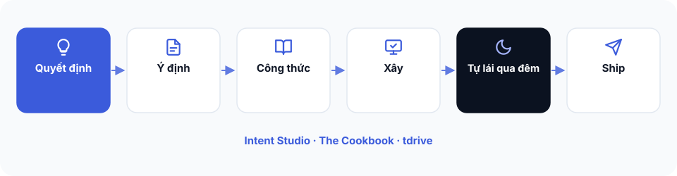

# Bài 0 — Bắt đầu ở đây

**Bạn đang ở đâu:** Điểm xuất phát của hành trình Quyết định → Ý định → Công thức → Xây → Tự lái qua đêm → Ship.

Nếu bạn chưa mua: các công thức, plugin và tdrive nằm trong ZIP bạn nhận sau khi mua tại [https://arealisticdreamer.com/cookbook](https://arealisticdreamer.com/cookbook).

Bạn có thể bắt đầu ngay với Intent Studio trên ChatGPT để quyết định ứng dụng và viết bản ý định một trang, rồi tham khảo 6 công thức và DESIGN/FEEL. Nếu có Claude Code, bạn dùng extension để kiểm tra ý định và tạo BRIEF.md cho bất kỳ AI coder nào. Muốn tdrive tự xây ứng dụng, kể cả qua đêm, bạn cần thêm [AgentKit](https://go.arealisticdreamer.com/agentkit) hoặc [Buildflow (trong khóa Ship with Claude)](https://arealisticdreamer.com/ship-with-claude), máy Mac và tmux; script preflight sẽ kiểm tra những gì còn thiếu.

Chào bạn, mình là Tony. Cảm ơn bạn đã chọn The Cookbook.

Bạn vừa nhận một bộ công cụ để đi từ ý tưởng ứng dụng đến một bản có thể xây dựng, kiểm tra và đưa cho người khác sử dụng. Trong đó có Intent Studio để làm rõ ý định, sáu công thức từ những ứng dụng thực tế và một extension giúp chuyển ý định sang công cụ xây dựng. Bộ ZIP còn có tdrive để tự động chạy những công việc xây dựng đủ điều kiện, cùng tài liệu để bạn tự làm và kiểm tra kết quả.

Bạn không cần cài hết mọi thứ mới bắt đầu được.

Nếu muốn nhìn toàn cảnh trước, [**xem video hướng dẫn 4 phút**](https://arealisticdreamer.com/cookbook#video).

## Hành trình của bạn

**Quyết định → Ý định → Công thức → Xây → Tự lái qua đêm → Ship**

- **Quyết định:** Chọn đúng ứng dụng và phạm vi phiên bản đầu tiên.
- **Ý định:** Viết rõ ứng dụng phải làm gì, quyết định nào đã chốt và kết quả nào được xem là đạt.
- **Công thức:** Intent Studio tự đối chiếu hành trình người dùng với các công thức trong The Cookbook và gắn những quy tắc, tình huống dễ sai và bước kiểm tra phù hợp. Bạn không cần tự chọn.
- **Xây:** Giao việc cho công cụ lập trình AI, chạy thử và kiểm tra luồng đầu tiên.
- **Tự lái qua đêm:** Nếu máy và công cụ phù hợp, dùng tdrive để tiếp tục công việc khi bạn không trực tiếp ngồi điều khiển.
- **Ship:** Kiểm tra, sửa lỗi và đưa một bản dùng được đến người dùng đầu tiên.

Claude Code là công cụ cho phép bạn giao việc lập trình cho Claude ngay trên máy tính, bao gồm đọc file và chạy lệnh khi bạn cho phép. AgentKit và Buildflow là những bộ công cụ hỗ trợ tổ chức và thực hiện công việc xây dựng ứng dụng bằng AI. Bạn có thể dùng The Cookbook ngay cả khi chưa có các công cụ này.

## Chọn đường đi của bạn

| Bạn đang ở tình huống nào? | Nên học theo thứ tự |
| --- | --- |
| Đã dùng Claude Code | Bài 1 → 3 → 4 → 5 → 6 → 8 nếu đủ điều kiện |
| Có AgentKit hoặc Buildflow nhưng chưa dùng được | Bài 1 → 3 → 4 → 6 → 8 → 9 |
| Đã xây nhiều dự án | Bài 3 → 4 → 5 → 6 → 9 |
| Không biết lập trình | Bài 1 → 2 → 3 (ChatGPT Project) → 5 → 6 khi sẵn sàng |
| Freelancer làm dự án cho khách | Bài 1 → 2 → 4 → 5 → 6 → 9 |

Các số bài là hướng dẫn điều hướng, không phải điều kiện bắt buộc. Bạn có thể bỏ qua phần mình đã quen.

Nếu đã có AgentKit hoặc Buildflow nhưng chưa biết bắt đầu từ đâu, cứ làm bản ý định trước. Extension sẽ hỗ trợ chuyển việc sang công cụ phù hợp, bạn chưa cần học hết quy trình bên trong của từng công cụ.

Nếu chưa biết lập trình, bạn có thể hoàn thành bản ý định bằng ChatGPT trước. Việc mô tả ứng dụng trong ChatGPT chưa tự động tạo hoặc vận hành ứng dụng. Khi sẵn sàng xây, bạn sẽ có bản yêu cầu đủ rõ để giao cho công cụ phù hợp.

## Tài liệu nằm ở đâu?

Trong `the-cookbook-v1.0.0.zip`, bạn có:

- `START-HERE.md`: chính là bài hướng dẫn bắt đầu này.
- `guide/`: toàn bộ Bài 1 đến Bài 10, đọc được offline.
- `intent-studio/chatgpt-project/`: tài liệu thiết lập Intent Studio trong ChatGPT.
- `INSTALL.md`: hướng dẫn cài đặt đầy đủ; `setup.sh`: tự cài những phần có thể và báo những bước bạn cần làm tiếp.
- `recipes/`: sáu công thức ứng dụng.
- `design-kits/`: các bộ gợi ý thiết kế giao diện và trải nghiệm.
- `tdrive-beta/`: bộ công cụ tự động chạy dành cho môi trường phù hợp.

Bạn có thể sử dụng bộ ZIP mà không cần đăng nhập website. Nếu cần tải lại bản ZIP mới nhất, hãy vào [https://arealisticdreamer.com/members](https://arealisticdreamer.com/members), nhập email đã dùng mua hàng và mở liên kết đăng nhập một lần (magic link) được gửi đến email đó.

**Bước tiếp theo:** [Bài 1: Chốt quyết định cho ứng dụng đầu tiên](guide/01-quyet-dinh-app.md). Nếu đã có một quyết định rõ ràng, bạn có thể bỏ qua bài này.
