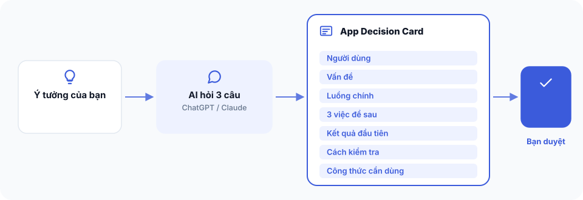

# Bài 1 — Chốt quyết định cho ứng dụng đầu tiên




**Bạn đang ở đâu:** Quyết định → Ý định → Công thức → Xây → Tự lái qua đêm → Ship. Bạn đang ở bước Quyết định.

## Mục tiêu

Bạn sẽ có một App Decision Card, tức bản quyết định một trang về ứng dụng sẽ xây, cho ai dùng, phạm vi đến đâu và cách biết phiên bản đầu tiên đã đạt.

## Cách 1 — Nhờ AI làm

Mở ChatGPT, Claude trên trình duyệt hoặc Claude Code. Không cần cài The Cookbook trước.

Sao chép đoạn sau vào cuộc trò chuyện mới:

```text
Mình muốn làm một app nhưng cần chốt hướng đi trước.

Hãy hỏi tối đa 3 câu để hiểu người dùng, vấn đề và luồng công việc chính.

Sau đó viết một App Decision Card gồm:
1. Người dùng mục tiêu
2. Vấn đề cần giải quyết
3. Một luồng công việc chính
4. Ba thứ chưa làm ở phiên bản đầu
5. Kết quả đầu tiên người dùng cần thấy
6. Một cách kiểm tra thành công
7. Recipe The Cookbook nên dùng

Nếu sau 3 câu vẫn chưa rõ hướng đi, hãy đề xuất 2 luồng nhỏ hơn để mình chọn.

Chờ mình duyệt trước khi đi tiếp.
Chưa hỏi về công nghệ và chưa viết code.
```

AI sẽ giúp bạn thu hẹp lựa chọn và trình bày kết quả. Bạn vẫn là người quyết định phạm vi, duyệt bản cuối và lưu tài liệu. AI trên trình duyệt không tự lưu file vào máy của bạn.

## Cách 2 — Tự làm từng bước

1. Mở một tài liệu trống, đặt tên `App Decision Card`.
2. Viết một câu xác định ai sẽ dùng ứng dụng.
3. Viết vấn đề cụ thể mà người đó đang gặp.
4. Chọn đúng một luồng công việc chính, từ hành động đầu tiên đến kết quả.
5. Ghi ba tính năng sẽ chưa làm.
6. Chọn một kết quả có thể nhìn thấy và một cách kiểm tra được.

Ví dụ với ứng dụng đặt lịch cho tiệm tóc:

| Nội dung | Quyết định |
| --- | --- |
| Người dùng | Khách muốn đặt lịch cắt tóc |
| Vấn đề | Phải nhắn tin hỏi giờ còn trống |
| Luồng chính | Chọn giờ → Xác nhận → Nhận kết quả đặt lịch |
| Chưa làm | Thanh toán, phân ca nhân viên, tích điểm |
| Kết quả đầu tiên | Khách đặt được một lịch còn trống |
| Kiểm tra | Một khung giờ đã đặt không thể được đặt trùng |
| Công thức | booking |

Đọc lại và tự hỏi: một người khác có hiểu chính xác mình định làm gì không? Nếu có, hãy duyệt bản này.

## Kiểm tra đã xong

Bạn có một Decision Card vừa một màn hình, có một luồng chính, ba phần loại trừ và một điều kiện kiểm tra cụ thể.

Chưa cần chọn ngôn ngữ lập trình, mua máy chủ hay cài công cụ nào.

## Bị kẹt?

Dán vào ChatGPT hoặc Claude:

```text
Đây là App Decision Card của mình. Hãy chỉ ra những quyết định còn mơ hồ, đề xuất cách thu hẹp thành một luồng người dùng có thể kiểm tra được, và hỏi mình một câu quan trọng nhất để chốt.
```

Hoặc hỏi trong kênh Discord #cookbook.

**Bước tiếp theo:** [Bài 2: Biến quyết định thành bản ý định](02-ban-y-dinh.md).
