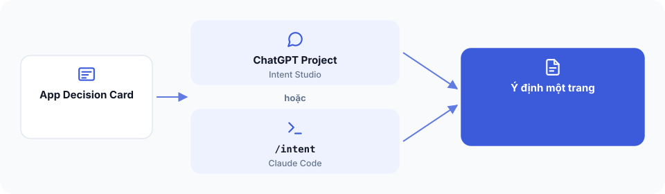

# Bài 2 — Biến quyết định thành bản ý định




**Bạn đang ở đâu:** Quyết định → Ý định → Công thức → Xây → Tự lái qua đêm → Ship. Bạn đã chốt ứng dụng, giờ cần mô tả đủ rõ để AI có thể xây đúng.

## Mục tiêu

Bạn sẽ có một bản ý định ứng dụng dài khoảng một trang, ghi rõ luồng chính, những quyết định quan trọng, phạm vi và điều kiện nghiệm thu.

## Cách 1 — Nhờ AI làm

Bạn có hai lựa chọn.

**Lựa chọn A: ChatGPT Project**

Project là một không gian trong ChatGPT giữ chung hướng dẫn và tài liệu cho các cuộc trò chuyện liên quan. Nếu đã tạo Project với bộ Intent Studio ở Bài 3, bạn có thể mở Project đó ngay. Nếu chưa, vẫn có thể dùng ChatGPT bình thường với prompt sau và thiết lập Project sau.

**Lựa chọn B: Claude Code**

Nếu đã cài extension, mở Claude Code và trò chuyện với Claude để bắt đầu viết bản ý định bằng Intent Studio.

Ở cả hai cách, hãy đưa App Decision Card đã duyệt cho AI cùng yêu cầu:

```text
Đây là App Decision Card mình đã duyệt.

Hãy dùng Intent Studio để biến nó thành bản ý định một trang, gồm:
- Người dùng và vấn đề
- Một luồng công việc chính
- Các quyết định quan trọng
- Phạm vi phiên bản đầu tiên
- Những việc chưa làm
- Điều kiện nghiệm thu có thể kiểm tra
- Các công thức The Cookbook được Intent Studio tự đối chiếu với từng bước trong hành trình người dùng và ghi vào bản ý định.

Hãy hỏi mình những chỗ còn thiếu, đừng tự quyết định thay mình.

Nếu đang trong Claude Code, hãy giúp mình viết bản ý định bằng Intent Studio.

Chưa chuyển sang viết code.
```

AI sẽ giúp soạn thảo. Bạn cần tự trả lời các quyết định về nghiệp vụ và duyệt kết quả. ChatGPT trên trình duyệt không tự tạo file trong dự án của bạn.

## Cách 2 — Tự làm từng bước

1. Lấy App Decision Card ở Bài 1.
2. Viết luồng chính theo từng hành động của người dùng.
3. Với mỗi hành động, ghi hệ thống cần phản hồi thế nào.
4. Ghi các quy tắc quan trọng, đặc biệt ở trường hợp lỗi hoặc ngoại lệ.
5. Ghi những tính năng nằm ngoài phạm vi.
6. Viết điều kiện nghiệm thu theo dạng: thực hiện hành động X, hệ thống phải cho kết quả Y.
7. Lưu bản ý định đã duyệt để dùng khi chuyển sang xây dựng.

Ví dụ, trong ứng dụng đặt lịch, quy tắc "một khung giờ chỉ có một lịch được xác nhận" phải được ghi rõ. Nếu không, AI có thể tạo giao diện đẹp nhưng vẫn cho hai người đặt trùng giờ.

## Kiểm tra đã xong

Bản ý định của bạn giải thích được người dùng làm gì, hệ thống phải làm gì, trường hợp nào cần ngăn chặn và kết quả nào được xem là đạt.

Những quyết định chưa chốt được ghi rõ, không bị AI âm thầm tự chọn.

## Bị kẹt?

```text
Hãy đóng vai người kiểm tra yêu cầu ứng dụng. Đọc bản ý định này, tìm các quyết định nghiệp vụ còn thiếu và các điều kiện nghiệm thu chưa đo được. Hỏi mình để hoàn thiện, không tự thêm tính năng.
```

Hoặc hỏi trong kênh Discord #cookbook.

Bạn có thể sử dụng Intent Studio bằng cách trò chuyện trong ChatGPT Project của mình (thiết lập ở Bài 3), hoặc trò chuyện trực tiếp với Claude trong Claude Code. Nếu có tab-pilot, Claude còn có thể tự nhờ ChatGPT xem lại nhanh các giả định kinh doanh trong bản ý định, rồi kiểm tra phản hồi trước khi mang về. Những gì ảnh hưởng đến quyết định xây app vẫn phải được bạn xem xét và chốt.

**Bước tiếp theo:** [Bài 3: Chuẩn bị không gian làm việc](03-cai-dat.md). Nếu đã cài extension và ChatGPT Project, có thể bỏ qua phần thiết lập tương ứng.
