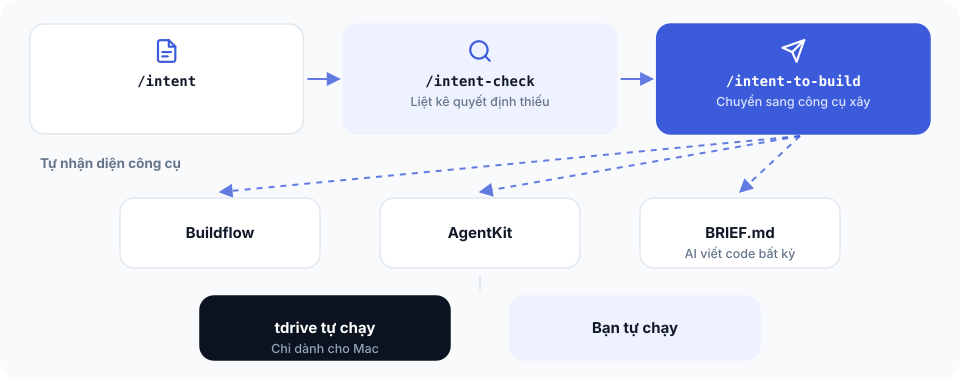

# Bài 4 — Kiểm tra và bàn giao bản ý định




**Bạn đang ở đâu:** Quyết định → Ý định → Công thức → Xây → Tự lái qua đêm → Ship. Bạn đang kiểm tra bản ý định và chuẩn bị bàn giao cho công cụ xây ứng dụng.

## Mục tiêu

Bạn sẽ kiểm tra bản ý định trước khi viết code, giải quyết những quyết định còn thiếu và bàn giao công việc cho công cụ phù hợp.

Intent Studio giúp bạn làm việc này bằng cách trò chuyện với Claude. Bạn chỉ cần nói điều mình muốn, không cần nhớ tên lệnh.

Intent Studio cũng tự đối chiếu hành trình người dùng với các công thức có sẵn trong The Cookbook. Nếu có công thức phù hợp, Claude sẽ gắn vào bản ý định và chuẩn bị đưa sang công cụ xây dựng. Bạn không cần tự tìm hay chọn công thức.

## Cách 1 — Nhờ AI làm

Mở Claude Code trong thư mục dự án đã có bản ý định.

Dán yêu cầu:

```text
Mình có bản ý định cho ứng dụng này.

Hãy kiểm tra bản ý định trước khi xây.

Đối chiếu từng bước trong hành trình người dùng với các công thức có sẵn. Bước nào chưa có công thức phù hợp thì ghi rõ là phần còn thiếu.

Kiểm tra các quyết định cần thiết. Chỉ hỏi mình những quyết định còn thiếu mà bạn cần mình trả lời. Đừng tự đoán.

Khi bản ý định đã đạt, hãy chuẩn bị bàn giao cho công cụ xây dựng phù hợp. Tự đính kèm các công thức liên quan nếu có.

Hãy báo mình biết:
- Builder nào được chọn
- Runner nào được chọn
- Công thức nào đã được gắn vào, cho phần việc nào
- Profile nào đang áp dụng
- Phần nào chưa có công thức
- Mình cần làm gì tiếp theo

Chưa bắt đầu xây cho đến khi mình duyệt.
```

Claude sẽ kiểm tra bản ý định, hỏi những điểm còn thiếu và chuẩn bị bàn giao.

Bạn vẫn là người duyệt các quyết định quan trọng, quyền chạy lệnh và những hành động có ảnh hưởng đến dự án.

## Cách 2 — Tự làm từng bước

**Bước 1. Mở bản ý định**

Mở dự án trong Claude Code.

Nếu chưa có bản ý định, nói:

> Giúp mình viết bản ý định cho ứng dụng này. Hãy hỏi những điều cần quyết định trước khi xây.

Nếu đã có `INTENT.md`, Claude có thể tiếp tục từ bản hiện tại.

**Bước 2. Kiểm tra bản ý định**

Nói:

> Kiểm tra bản ý định này. Cho mình biết phần nào đã rõ, phần nào còn thiếu. Chỉ hỏi những quyết định mình cần trả lời.

Claude sẽ kiểm tra các bước trong hành trình người dùng, đối chiếu công thức nếu có `DOMAIN.md`, và xem những quyết định quan trọng đã được trả lời chưa.

Mỗi bước trong hành trình phải có công thức tương ứng hoặc được ghi rõ là chưa có công thức phù hợp.

Với mỗi công thức được gắn vào, những quyết định liên quan đến người dùng phải được trả lời hoặc đánh dấu còn mở.

**Bước 3. Trả lời những điểm còn thiếu**

Trả lời các câu hỏi Claude đưa ra.

Nếu một quyết định chưa thể chốt, bạn có thể yêu cầu Claude ghi rõ là còn mở. Những điểm cần giải quyết trước khi xây vẫn phải được xử lý.

Sau đó nói:

> Kiểm tra lại bản ý định với những câu trả lời vừa rồi.

**Bước 4. Chuẩn bị bàn giao**

Khi bản ý định đã đạt, nói:

> Chuyển bản ý định sang build. Hãy tự tìm công cụ phù hợp, chuẩn bị tài liệu và công thức cần thiết. Cho mình xem kết quả trước khi bắt đầu xây.

Claude sẽ nhận diện công cụ đang có và chuẩn bị tài liệu theo cách công cụ đó sử dụng được.

**Bước 5. Đọc kết quả bàn giao**

Kiểm tra công cụ được chọn, phạm vi cần xây, những công thức được gắn vào và việc nào cần bạn xác nhận.

Chỉ cho phép bắt đầu khi bạn đã hiểu và đồng ý với kế hoạch.

### Claude tự nhận diện những gì?

| Thành phần | Cách hoạt động |
| --- | --- |
| Builder | Ưu tiên Buildflow, sau đó AgentKit. Nếu không có cả hai, tạo BRIEF.md để dùng với Cursor, Codex, Claude Code hoặc AI coder khác. |
| Runner | Dùng tdrive nếu đã cài và bạn muốn chạy tự động. Nếu không, bạn tự chạy công cụ xây dựng. |
| Công thức | Đọc DOMAIN.md nếu có, tự ghép công thức vào từng bước của hành trình và chuẩn bị đính kèm khi bàn giao. |
| Profile | Ưu tiên profile được chỉ định, sau đó PROFILE.md trong dự án, cuối cùng là profile trống đi kèm. |

Builder là công cụ thực hiện việc xây dựng. Runner là công cụ tổ chức và điều khiển việc chạy.

Có `BRIEF.md` để sử dụng với một AI coder bất kỳ không có nghĩa là công cụ đó chạy được qua tdrive.

Intent Studio vẫn hoạt động khi không có `DOMAIN.md` hoặc bất kỳ công thức nào. Bạn có thể dùng riêng Intent Studio để chuẩn bị một bản ý định rõ ràng.

## Kiểm tra đã xong

Bạn đã đạt khi:

- Bản ý định đã được kiểm tra, các quyết định cần thiết đã được trả lời hoặc ghi rõ là còn mở.
- Mỗi bước trong hành trình người dùng có công thức tương ứng hoặc được ghi rõ là chưa có công thức.
- Claude cho biết builder, runner, profile và những công thức được bàn giao.
- Bạn biết tài liệu nào sẽ được sử dụng và cần làm gì tiếp theo.
- Chưa có công việc xây dựng nào bắt đầu khi bạn chưa duyệt.

Nếu không có Buildflow hoặc AgentKit, bạn vẫn có thể bàn giao bằng `BRIEF.md`.

Nếu không có tdrive, bạn vẫn xây thủ công được.

Bạn cũng có thể cá nhân hóa cách Intent Studio làm việc bằng `PROFILE.md` sau lần đầu sử dụng. Việc này hoàn toàn tùy chọn.

## Bị kẹt?

Nếu Claude chưa bàn giao được, hãy nói:

```text
Hãy kiểm tra vì sao bản ý định này chưa bàn giao được.

Phân biệt những lỗi bắt buộc phải sửa với những công cụ tùy chọn đang thiếu.

Nếu thiếu công thức, hãy ghi rõ phần nào chưa có công thức phù hợp. Đừng tự thêm yêu cầu ngoài phạm vi đã duyệt.

Nếu không có Buildflow hoặc AgentKit, hãy hướng dẫn mình dùng BRIEF.md với một AI coder khác.

Cho mình biết bước nhỏ nhất cần làm tiếp theo.
```

Nếu Claude yêu cầu bạn tự chọn công thức, hãy nhắc Claude đối chiếu từng bước trong hành trình với `DOMAIN.md` và tự cập nhật phần `Recipes` trong `INTENT.md`.

Hoặc hỏi trong kênh Discord #cookbook.

**Bước tiếp theo:** [Bài 5: Công thức tự áp dụng như thế nào](05-cong-thuc.md).

### Cá nhân hóa Intent Studio để làm việc theo cách của bạn

Phần này dành cho bạn sau khi đã hoàn thành bản ý định đầu tiên. Nếu chưa có nhu cầu, bạn cứ sử dụng profile trống đi kèm.

`PROFILE.md` là tài liệu mô tả cách bạn thường làm việc, công nghệ quen dùng, những nguyên tắc thiết kế và tiêu chí chất lượng. Intent Studio có thể tham khảo tài liệu này để đưa ra đề xuất phù hợp hơn với cách bạn xây ứng dụng.

## Cách 1 — Nhờ AI làm

Mở Claude Code trong thư mục có tài liệu của bạn, sau đó dán:

```text
Mình muốn Intent Studio làm việc theo cách của mình.

Hãy đọc PROFILE-FROM-DOCS.md, hỏi mình những tài liệu cần thiết và tạo PROFILE.md mô tả:
- Cách mình tổ chức công việc
- Công nghệ mình thường sử dụng
- Những nguyên tắc thiết kế
- Cách mình kiểm tra chất lượng
- Các tiêu chuẩn mình muốn giữ giữa nhiều dự án

Cho mình xem để duyệt, không đưa thông tin nhạy cảm vào profile.

Profile không được thay đổi những quyết định đã chốt trong bản ý định.
```

Bạn tự chọn tài liệu cho AI đọc và duyệt nội dung profile trước khi sử dụng.

## Cách 2 — Tự làm từng bước

1. Mở `PROFILE-FROM-DOCS.md` trong bộ The Cookbook.
2. Chọn các tài liệu mô tả cách bạn làm việc hoặc những dự án trước đây.
3. Tạo hoặc chỉnh `./PROFILE.md`.
4. Kiểm tra lại nội dung, bỏ thông tin bí mật và hướng dẫn mâu thuẫn.
5. Nhờ Claude kiểm tra hoặc cập nhật bản ý định để áp dụng profile vào công việc.
6. Nếu lưu profile ở nơi khác, hãy cho Claude biết đường dẫn đến file profile bạn muốn sử dụng.

Thứ tự ưu tiên là profile được chỉ định bằng `--profile <path>`, tiếp đến `./PROFILE.md`, cuối cùng là profile trống đi kèm.

## Kiểm tra đã xong

Intent Studio có thể áp dụng các nguyên tắc bạn đã chọn khi đề xuất và kiểm tra ứng dụng, nhưng vẫn giữ nguyên những quyết định trong bản ý định đã duyệt.

Bạn có thể thay đổi profile bất cứ lúc nào. Không cần cá nhân hóa để bắt đầu xây ứng dụng đầu tiên.
