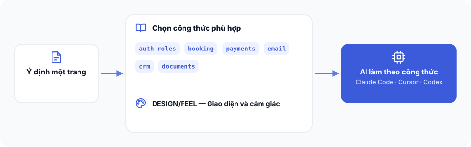

# Bài 5 — Công thức tự áp dụng như thế nào




**Bạn đang ở đâu:** Quyết định → Ý định → Công thức → Xây → Tự lái qua đêm → Ship. Bạn đang tìm hiểu cách công thức được tự động đưa vào công việc xây dựng.

## Mục tiêu

Bạn sẽ hiểu cách Intent Studio tự tìm công thức phù hợp, kiểm tra những quyết định cần thiết và đưa công thức sang công cụ xây dựng.

**Bạn không cần liệt kê hay tự chọn công thức.**

Khi bạn mô tả ứng dụng và hành trình người dùng, Intent Studio sẽ tự đối chiếu với những công thức có sẵn. Bạn chỉ cần trả lời những quyết định thực sự thuộc về mình.

Các công thức cũng có thể dùng độc lập, ngay cả khi bạn không sử dụng Intent Studio hay tdrive.

## Công thức được tự áp dụng như thế nào?

The Cookbook có một file `DOMAIN.md`, là danh mục các công thức trong bộ kit.

Khi làm việc với bản ý định, Intent Studio dùng danh mục này để tìm công thức phù hợp cho từng bước trong hành trình người dùng.

Quy trình có ba phần.

**1. Khi viết bản ý định**

Claude đọc hành trình người dùng và đối chiếu từng bước với `DOMAIN.md`.

Ví dụ, nếu ứng dụng có bước khách đặt lịch, Claude tìm công thức liên quan đến đặt lịch.

Nếu có công thức phù hợp, Claude ghi vào phần `Recipes` trong `INTENT.md`.

Nếu một bước chưa có công thức phù hợp, Claude ghi rõ phần đó còn thiếu công thức.

Một bước chưa có công thức không có nghĩa là ứng dụng không thể xây. Điều quan trọng là phần đó được nhận diện rõ, thay vì âm thầm bỏ qua.

**2. Khi kiểm tra bản ý định**

Claude kiểm tra hai điều:

- Mỗi bước trong hành trình người dùng đã được gắn với công thức tương ứng hoặc ghi rõ là chưa có công thức.
- Những quyết định dành cho người dùng trong từng công thức đã được trả lời hoặc đánh dấu còn mở.

Nếu còn quyết định cần bạn chốt, Claude sẽ hỏi.

Bạn không cần tự đọc toàn bộ workbook để tìm câu hỏi. Claude sẽ đưa những quyết định cần thiết ra cho bạn.

**3. Khi bàn giao cho công cụ xây dựng**

Claude tự chuẩn bị công thức theo công cụ được tìm thấy.

| Công cụ | Claude bàn giao như thế nào |
| --- | --- |
| Buildflow | Mỗi feature nhận công thức liên quan làm blueprint để xây dựng. |
| AgentKit | Claude sao chép công thức vào docs/cookbook/ và ghi trong brief để AgentKit đọc các file đó. |
| Cursor, Codex, Claude Code hoặc AI coder khác | Claude tạo BRIEF.md, liệt kê rõ những file công thức cần đính kèm. |

Với AgentKit, nội dung công thức còn được đưa vào từng phần của quá trình xây dựng:

- Những quyết định trong công thức được đưa ra khi duyệt kế hoạch.
- Những tình huống dễ sai trở thành các trường hợp biên cần xử lý.
- Những điều công thức yêu cầu phải bảo đảm trở thành tiêu chí nghiệm thu.
- Những bài kiểm tra trong công thức được chạy ở giai đoạn testing.

Như vậy, công thức được sử dụng từ lúc lập kế hoạch đến lúc kiểm tra kết quả.

## Một công thức giúp được gì?

Mỗi công thức là một workbook ghi lại cách xử lý một loại công việc thường gặp khi xây ứng dụng.

Trong đó có bốn phần quan trọng:

| Phần | Ý nghĩa |
| --- | --- |
| Decisions | Những quyết định cần có trước khi xây hoặc trong lúc duyệt kế hoạch. |
| Traps | Những tình huống dễ sai mà builder cần chú ý. |
| Guarantees | Những điều ứng dụng phải bảo đảm khi hoàn thành. |
| Tests | Những bài kiểm tra để xác nhận kết quả thực sự đạt yêu cầu. |

Ví dụ, với ứng dụng đặt lịch, việc tạo được một lịch hẹn chưa đủ.

Bạn cần kiểm tra điều gì xảy ra khi hai lần đặt lịch cùng sử dụng một khung giờ.

Nếu hệ thống vẫn cho đặt trùng một khung giờ không còn trống, phần đặt lịch chưa đạt.

Công thức giúp builder có những yêu cầu kiểm tra cụ thể như vậy.

## Những công thức có sẵn

The Cookbook hiện có sáu nhóm công thức.

Bảng này để bạn tham khảo và hiểu bộ kit đang hỗ trợ những gì. Bạn không cần chọn từ bảng trước khi bắt đầu.

| Công thức | Công việc được hỗ trợ |
| --- | --- |
| auth-roles | Đăng nhập, phân quyền người dùng |
| booking | Đặt lịch, kiểm tra khung giờ và xác nhận |
| payments | Đơn hàng, thanh toán, trạng thái giao dịch |
| email | Gửi thư, thông báo và xử lý lỗi gửi |
| crm | Khách hàng, liên hệ, cơ hội và chăm sóc |
| documents | Tài liệu, file và quy trình xử lý tài liệu |

Các workbook nằm trong thư mục `recipes/`.

Chẳng hạn, công thức đặt lịch có thể được đọc tại `recipes/booking.workbook.md`.

Nếu phiên bản đầu của ứng dụng chỉ có đặt lịch và chưa thu tiền, Claude không cần đưa công thức thanh toán vào chỉ vì nó có sẵn.

Việc áp dụng công thức phải dựa trên hành trình và phạm vi đã thống nhất.

## Cách xem hoặc thay đổi công thức

Bạn luôn có thể hỏi Claude những công thức đang được dùng.

Nói:

> App này đang dùng công thức nào, vì sao?

Claude sẽ dựa vào phần `Recipes` trong `INTENT.md` để giải thích từng công thức gắn với phần nào của ứng dụng.

Nếu muốn thay đổi, bạn có thể nói:

> Bỏ công thức X.

Hoặc:

> Thêm công thức Y.

Claude sẽ cập nhật phần `Recipes`, sau đó kiểm tra lại bản ý định và những quyết định liên quan.

Bạn không cần tự sửa danh mục hoặc tự chuẩn bị lại toàn bộ tài liệu bàn giao.

## Dùng một công thức riêng trong ứng dụng đang có

Bạn không bắt buộc phải dùng cả The Cookbook.

Giả sử bạn đã có ứng dụng và đang làm việc với Cursor, Codex hoặc Claude Code. Bạn chỉ muốn cải thiện một phần cụ thể.

Bạn có thể mở thư mục `recipes/`, lấy workbook tương ứng và đính kèm cho AI coder đang sử dụng.

Sau đó nói:

> Xây theo công thức này cho app của mình.

AI coder có thể dùng các quyết định, tình huống dễ sai, điều kiện bảo đảm và bài kiểm tra trong workbook để thực hiện công việc.

Bạn không cần tạo lại dự án, cài tdrive hay đi qua Intent Studio chỉ để dùng một công thức.

Tương tự, Intent Studio có thể viết và kiểm tra bản ý định mà không cần công thức nào. `DOMAIN.md` là phần tùy chọn.

## DESIGN và FEEL có bắt buộc không?

Không.

Trong `design-kits/` có các bộ DESIGN và FEEL giúp định hướng giao diện và trải nghiệm.

- **DESIGN:** Gợi ý cấu trúc và cách tổ chức giao diện.
- **FEEL:** Giúp xác định cảm giác sử dụng và cách tương tác mong muốn.

Bạn có thể để Claude đề xuất một bộ phù hợp, hoặc tự đính kèm bộ mình muốn dùng.

Bạn cũng có thể không sử dụng phần này.

Các bộ thiết kế là tùy chọn, không phải điều kiện để áp dụng công thức xây dựng.

## Kiểm tra đã xong

Mở `INTENT.md` và xem phần `Recipes`.

Bạn cần thấy:

- Các công thức được gắn đúng với những bước liên quan trong hành trình người dùng.
- Những bước chưa có công thức phù hợp được ghi rõ là phần còn thiếu.
- Những quyết định cần thiết của từng công thức đã được trả lời hoặc đánh dấu còn mở.
- Không có công thức được thêm vào chỉ vì nó có sẵn trong bộ kit.

Khi bàn giao, Claude cũng phải chuẩn bị các file công thức theo đúng cách builder sử dụng.

Bạn không cần tự chọn hay tự sao chép công thức nếu đang dùng quy trình tự động của Intent Studio.

## Bị kẹt?

Nếu không rõ vì sao một công thức xuất hiện, hãy nói:

```text
Hãy đọc phần Recipes trong INTENT.md.

Giải thích mỗi công thức đang phục vụ bước nào trong hành trình người dùng.

Cho mình biết:
- Có bước nào chưa có công thức phù hợp không?
- Có công thức nào không gắn với yêu cầu thực tế không?
- Còn quyết định nào mình cần trả lời không?

Nếu cần thay đổi, hãy cập nhật phần Recipes rồi kiểm tra lại bản ý định.

Đừng thêm tính năng ngoài phạm vi đã thống nhất.
```

Nếu không tìm thấy `DOMAIN.md`, Intent Studio vẫn có thể tiếp tục mà không dùng công thức.

Nếu dùng một công thức riêng trong ứng dụng hiện tại, hãy bảo đảm AI coder đã được cung cấp file workbook và hiểu phần nào của ứng dụng cần áp dụng.

Hoặc hỏi trong kênh Discord #cookbook.

**Bước tiếp theo:** [Bài 6: Chạy lần xây dựng đầu tiên](06-build-dau-tien.md).
