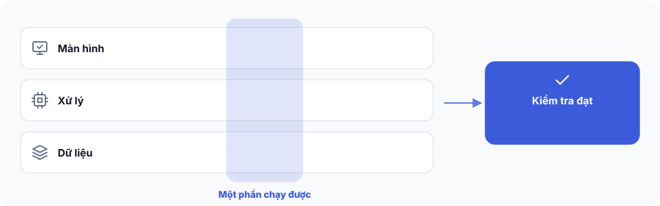

# Bài 6 — Chạy lần xây dựng đầu tiên




**Bạn đang ở đâu:** Quyết định → Ý định → Công thức → Xây → Tự lái qua đêm → Ship. Bạn đã chuẩn bị bản ý định và bàn giao công việc, giờ bắt đầu Xây.

## Mục tiêu

Bạn sẽ chạy được phần đầu tiên của ứng dụng, hoàn thành một luồng từ hành động người dùng đến kết quả và kiểm tra được nó hoạt động đúng.

Ở lần đầu tiên, mình khuyên bạn chỉ xây **một luồng hoàn chỉnh nhỏ nhất từ đầu đến cuối**.

Một phần nhỏ nhưng chạy được và kiểm tra được sẽ giúp bạn biết công cụ xây dựng đang hoạt động đúng trước khi mở rộng.

## Cách 1 — Nhờ AI làm

Mở Claude Code trong dự án.

Nếu đã có bản ý định, dán:

```text
Mình muốn bắt đầu xây ứng dụng này.

Hãy kiểm tra bản ý định hiện tại.

Nếu còn quyết định cần thiết chưa được giải quyết, hãy hỏi mình trước khi viết code. Đừng tự đoán.

Khi bản ý định đã đạt, hãy chuyển sang build bằng công cụ phù hợp. Tự chuẩn bị và đính kèm các công thức liên quan nếu có.

Giữ nguyên phạm vi và các điều kiện kiểm tra đã thống nhất.

Ở lần xây đầu tiên, chỉ thực hiện một luồng hoàn chỉnh nhỏ nhất từ đầu đến cuối.

Trước khi bắt đầu, cho mình biết:
- Builder và runner sẽ sử dụng
- Luồng đầu tiên sẽ xây
- Những việc cần mình xác nhận
- Cách chạy thử và kiểm tra kết quả

Chờ mình duyệt trước khi bắt đầu.

Sau khi xây, hãy cho mình xem kết quả kiểm tra thực tế, những phần đã đạt và những lỗi còn lại.
```

Luồng hoàn chỉnh nhỏ nhất là một phần ứng dụng có thể sử dụng và kiểm tra từ đầu đến cuối.

Chẳng hạn, với ứng dụng đặt lịch: người dùng chọn giờ trống, xác nhận lịch hẹn và nhìn thấy kết quả.

Claude Code có thể chuẩn bị hoặc thực hiện việc xây dựng nếu được cấp quyền.

Bạn vẫn cần duyệt các hành động có rủi ro, cấu hình tài khoản bên ngoài và quyết định đưa ứng dụng lên môi trường thật.

## Cách 2 — Tự làm từng bước

**Bước 1. Mở dự án**

Mở Claude Code trong thư mục dự án.

Nếu đã có `INTENT.md`, dùng bản hiện tại làm điểm bắt đầu.

**Bước 2. Kiểm tra bản ý định**

Nói:

> Kiểm tra bản ý định này. Nếu còn điều gì cần mình quyết định trước khi xây, hãy hỏi mình.

Claude sẽ kiểm tra các quyết định, hành trình người dùng và những công thức liên quan nếu có.

Nếu bản ý định chưa đạt, hãy xử lý những điểm còn thiếu trước khi viết code.

**Bước 3. Chuyển sang xây dựng**

Khi bản ý định đã đạt, nói:

> Chuyển bản ý định sang build. Chuẩn bị công cụ và tài liệu cần thiết, rồi cho mình xem trước khi chạy.

Claude sẽ chọn đường bàn giao theo thứ tự:

1. Buildflow nếu có.
2. AgentKit nếu không có Buildflow.
3. `BRIEF.md` nếu không có hai công cụ trên.

Nếu có công thức phù hợp, Claude tự chuẩn bị chúng cho builder theo cách đã giải thích ở Bài 5.

Bạn không cần tự liệt kê hay chọn công thức.

**Bước 4. Duyệt luồng đầu tiên**

Nói:

> Chỉ xây một luồng hoàn chỉnh nhỏ nhất từ đầu đến cuối. Cho mình biết luồng nào sẽ được xây và cách kiểm tra trước khi bắt đầu.

Đọc lại phạm vi, những điều kiện nghiệm thu và các quyền builder sẽ sử dụng.

Nếu thấy công việc vượt quá phạm vi đã duyệt, yêu cầu Claude điều chỉnh trước khi chạy.

**Bước 5. Thực hiện lần xây đầu tiên**

Nếu dùng Buildflow hoặc AgentKit, thực hiện hoặc duyệt lần chạy theo hướng dẫn của builder.

Nếu không có hai công cụ này, bạn vẫn có thể dùng Cursor, Codex, Claude Code hoặc AI coder khác.

Khi đó, cung cấp `BRIEF.md` cùng những file công thức được liệt kê trong brief, nếu có.

Bạn có thể nói với AI coder:

> Hãy xây luồng đầu tiên theo BRIEF.md và các tài liệu đính kèm. Giữ đúng phạm vi, sau đó chạy kiểm tra theo điều kiện nghiệm thu.

Bạn không cần cài tdrive để chạy lần xây này.

Nếu đã có tdrive và muốn để công việc tự chạy khi không trực tiếp điều khiển, bạn có thể sử dụng ở Bài 8.

**Bước 6. Chạy thử và kiểm tra kết quả**

Khi builder báo hoàn thành, hãy chạy ứng dụng và thử luồng chính.

Với ứng dụng đặt lịch, thử:

1. Chọn một khung giờ còn trống.
2. Tạo lịch hẹn và xác nhận kết quả.
3. Thử đặt lại chính khung giờ đó khi nó không còn trống.

Nếu hệ thống vẫn cho đặt trùng, phần việc này chưa đạt.

Đây là một ví dụ về lý do cần kiểm tra kết quả thay vì chỉ đọc thông báo hoàn thành của AI.

**Bước 7. Xem báo cáo và quyết định bước tiếp theo**

Yêu cầu Claude cho biết:

- Phần nào đã xây xong và chạy được.
- Những bài kiểm tra nào đã thực hiện, kết quả ra sao.
- Những phần nào chưa xây.
- Những lỗi nào còn tồn tại.
- Việc nhỏ nhất nên làm tiếp theo.

Chưa cần mở rộng sang các phần khác cho đến khi luồng đầu tiên đạt yêu cầu.

## Kiểm tra đã xong

Bạn đã đạt khi có một phần ứng dụng chạy được, với kết quả kiểm tra có thể quan sát hoặc đối chiếu.

Bạn biết phần nào đã hoàn thành, phần nào chưa xây và lỗi nào còn tồn tại.

**AI nói xong chưa đủ, phải có kết quả kiểm tra.**

Nếu AI báo hoàn thành nhưng chưa có kết quả chạy thử hoặc kiểm tra tương ứng, bạn chưa nên xem phần việc đó là đạt.

Nếu một bài kiểm tra thất bại, hãy sửa và kiểm tra lại trước khi chuyển sang phần tiếp theo.

## Bị kẹt?

Nếu bản ý định chưa đạt, hãy nhờ Claude chỉ ra những quyết định còn thiếu thay vì bắt đầu xây ngay.

Nếu thiếu Buildflow hoặc AgentKit, dùng `BRIEF.md` với một AI coder khác.

Nếu builder báo xong nhưng ứng dụng không chạy đúng, hãy nói:

```text
Đây là bản ý định, kết quả chạy builder và lỗi hiện tại.

Hãy xác định bước bị lỗi và nguyên nhân có thể xảy ra.

Đề xuất một cách sửa nhỏ nhất, không mở rộng phạm vi ứng dụng.

Sau khi sửa, hãy chạy lại bài kiểm tra liên quan và cho mình xem kết quả thực tế.

Đừng đánh dấu hoàn thành nếu chưa có kết quả kiểm tra.
```

Nếu gặp lỗi liên quan đến tài khoản, quyền truy cập, thanh toán thật, dữ liệu cá nhân hoặc triển khai production, hãy yêu cầu Claude giải thích hành động cần thực hiện và chờ bạn xác nhận riêng.

Hoặc hỏi trong kênh Discord #cookbook.

**Bước tiếp theo:** [Bài 7: Kết nối tài liệu The Cookbook vào Claude](07-ket-noi-mcp.md). Nếu đang dùng đầy đủ tài liệu local và chưa cần bản cập nhật, bạn có thể để kết nối này làm sau.
