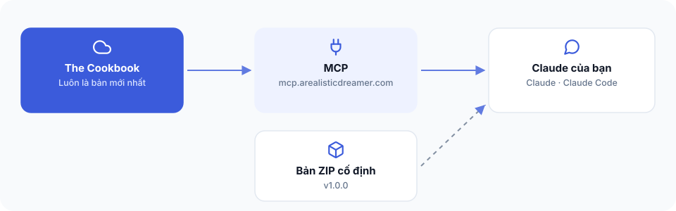

# Bài 7 — Kết nối tài liệu The Cookbook vào Claude




**Bạn đang ở đâu:** Quyết định → Ý định → Công thức → Xây → Tự lái qua đêm → Ship. Bạn đang bổ sung nguồn kiến thức được cập nhật cho quá trình xây dựng.

## Mục tiêu

Bạn sẽ kết nối Claude với tài nguyên The Cookbook được phép truy cập, để có thể tra cứu các công thức và tài liệu mới nhất ngay trong lúc làm việc.

## Kết nối MCP

Nếu đã hoàn thành Bài 3, `bash setup.sh` đã tự thêm kết nối MCP `ard` vào Claude Code.

**Bạn chỉ cần đăng nhập một lần:**

1. Mở Claude Code và gõ `/mcp`.
2. Chọn `ard` → **Authenticate**.
3. Đăng nhập bằng đúng email đã mua The Cookbook.
4. Khởi động lại Claude Code.

Hướng dẫn chi tiết, bao gồm kết nối riêng cho Claude web và Claude Desktop, nằm tại [Trang cài đặt đầy đủ, Bước 2](https://arealisticdreamer.com/cookbook/install).

Bạn không cần chạy thêm lệnh cài MCP.

## Cách sử dụng

### 1. Dành cho Claude Code
Khi cần một công thức cho ứng dụng đang xây, bạn có thể nói với Claude:

```text
Hãy tìm và đọc công thức mới nhất về đặt lịch trong The Cookbook. Cho mình biết những quyết định cần chốt trước khi áp dụng vào ứng dụng hiện tại.
```

### 2. Dành cho Google Antigravity (`agy`)
Nếu bạn sử dụng Google Antigravity thay vì Claude Code:
* **Token xác thực** được lưu tự động tại:
  👉 `C:\Users\nguyen.thanh-trung9\.gemini\config\ard-token.json`
* **Cơ chế hoạt động**: Sử dụng máy chủ MCP Hybrid (`cookbook`), tự động làm mới `access_token` thông qua OAuth `refresh_token` khi hết hạn và kết nối trực tiếp đến endpoint `https://mcp.arealisticdreamer.com/mcp`.
* **Cách prompt để AI LUÔN kiểm tra bản mới nhất (Latest Cookbook)**:
  Để đảm bảo AI không dùng bản lưu cũ trong cache mà luôn kiểm tra các cập nhật, bài học và công thức mới nhất trên máy chủ The Cookbook, hãy dùng cấu trúc prompt sau:

```text
Hãy gọi MCP cookbook/ard để kiểm tra bản mới nhất (latest) của The Cookbook cho [tính năng / công thức X]. 
Nếu có bài học, tài nguyên hoặc phiên bản cập nhật trên mcp.arealisticdreamer.com, hãy ưu tiên nội dung mới nhất đó và đối chiếu với ranh giới của ứng dụng hiện tại trước khi triển khai.
```

Claude/Antigravity sẽ tìm tài liệu mà tài khoản của bạn được phép truy cập.

Bạn có thể yêu cầu tìm bản công thức hiện hành thay vì chỉ dựa vào file đã tải trước đó.

Nếu MCP chưa hoạt động hoặc bạn cần đưa toàn bộ nội dung công thức vào một lần xây dựng, các file Markdown trong ZIP vẫn là phương án dự phòng.

## Kiểm tra đã xong

Claude có thể tìm và đọc một tài liệu The Cookbook mà tài khoản của bạn được phép truy cập.

## Bị kẹt?

Nếu không mở được bước đăng nhập hoặc Claude không đọc được công thức, xem [Trang cài đặt đầy đủ, phần Bị kẹt?](https://arealisticdreamer.com/cookbook/install).

Kiểm tra đúng email mua hàng, hoàn tất Authenticate và khởi động lại Claude Code trước khi thử lại.

Nếu vẫn chưa được, hỏi trong Discord **#cookbook**. Không gửi mật khẩu hay thông tin đăng nhập.

**Bước tiếp theo:** [Bài 8: Để tdrive chạy việc xây dựng qua đêm](08-tdrive-qua-dem.md). Nếu không cần tự động chạy, bạn có thể bỏ qua Bài 8.
