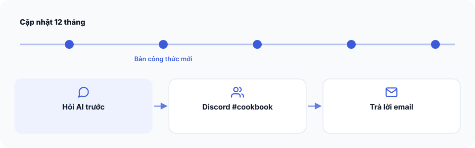

# Bài 10 — Cập nhật và nhận hỗ trợ




**Bạn đang ở đâu:** Quyết định → Ý định → Công thức → Xây → Tự lái qua đêm → Ship. Bạn đã hoàn thành một vòng xây dựng và đang chuyển sang duy trì, cải thiện.

## Cập nhật The Cookbook

Khi mua The Cookbook, bạn nhận được **12 tháng cập nhật** theo quyền lợi của sản phẩm.

Các bản cập nhật có thể bổ sung, chỉnh sửa công thức, hướng dẫn, tài liệu hoặc những thành phần công cụ tương ứng. Không phải bản cập nhật nào cũng cần áp dụng vào dự án đang chạy.

Bạn có thể tải lại bản ZIP mới nhất tại [https://arealisticdreamer.com/members](https://arealisticdreamer.com/members). Nếu cần truy cập, hãy dùng email đã mua hoặc nhận sản phẩm và mở magic link được gửi về email đó.

Nếu đã kết nối MCP, bạn có thể nhờ Claude tìm nội dung tài liệu hiện hành. Với plugin và các thành phần cài local, cần đối chiếu phiên bản và làm theo hướng dẫn cập nhật tương ứng. Đừng mặc định file trên máy được cập nhật tự động.

Khi cập nhật, hãy:

1. Xem thay đổi và ghi chú tương thích của phiên bản mới.
2. So sánh với bản đang sử dụng.
3. Sao lưu những file hoặc cấu hình đã tùy chỉnh.
4. Chỉ áp dụng thay đổi liên quan đến dự án.
5. Chạy lại các kiểm tra bị ảnh hưởng.

## Khi cần hỗ trợ

Bạn có thể hỏi về cách sử dụng, lỗi cài đặt, lựa chọn công thức hoặc quá trình xây dựng trong **Discord #cookbook**.

Để mình hoặc mọi người dễ hỗ trợ, hãy gửi theo mẫu:

```text
Mình đang dùng The Cookbook và gặp vấn đề sau:

1. Mình đã làm gì:
2. Mình mong đợi kết quả gì:
3. Điều thực tế đã xảy ra:
4. Hệ điều hành (OS):
5. Phiên bản đang dùng:

Thông báo lỗi hoặc kết quả kiểm tra:
[Chỉ dán phần liên quan, đã bỏ thông tin nhạy cảm]
```

Đừng đăng mật khẩu, khóa API, thông tin thanh toán hoặc dữ liệu cá nhân của khách hàng lên Discord.

Nếu vấn đề liên quan đến thanh toán, email nhận sản phẩm hoặc quyền truy cập, hãy **trả lời trực tiếp email mua hàng** để được kiểm tra riêng. Không cần công khai thông tin đơn hàng trong kênh chung.

## Tiếp tục từ đây

Sau lần xây đầu tiên, bạn đã có một cách làm có thể lặp lại. Khi bắt đầu ứng dụng mới, hãy dùng kinh nghiệm từ lần trước để xác định phạm vi rõ hơn, giúp AI đối chiếu và tự áp dụng công thức sát với hành trình người dùng hơn, đồng thời đặt điều kiện kiểm tra tốt hơn.

Mình sẽ tiếp tục cập nhật bộ tài liệu từ những tình huống và kinh nghiệm xây dựng thực tế.

**Bước tiếp theo:** [Bài 0: Bắt đầu ở đây](../START-HERE.md) nếu bạn muốn mở một vòng xây dựng mới. Nếu đang duy trì ứng dụng hiện tại, hãy tiếp tục với bản ý định và kết quả kiểm tra đã có.
