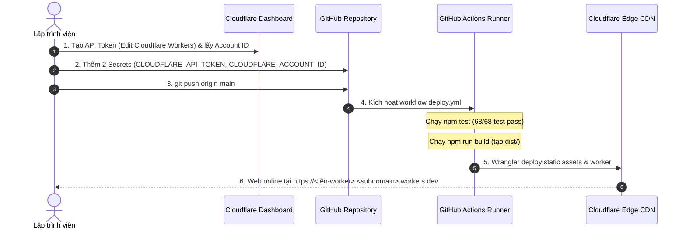

# Quy Trình Chuẩn Triển Khai CI/CD: GitHub Actions & Cloudflare Workers

Tài liệu hướng dẫn toàn diện kiến trúc, các công nghệ sử dụng và các bước thiết lập chuẩn để đưa dự án **Oops La Bookstore** lên mạng lưới **Cloudflare Edge** qua **GitHub Actions**.

---

## 1. Công Nghệ & Thành Phần Sử Dụng

| Thành phần | Công nghệ / Tool | Vai trò trong dự án |
| :--- | :--- | :--- |
| **Môi trường CI/CD** | **GitHub Actions** (`ubuntu-latest`) | Tự động hóa kiểm thử, đóng gói và triển khai mỗi khi đẩy code lên `main`. |
| **Runtime Engine** | **Node.js 22** Native | Chạy bộ test TypeScript nguyên bản bằng cờ `--experimental-strip-types` (nhẹ, không cần cài ts-node/tsc). |
| **Cổng Kiểm Định** | **Zero-Trust Test Gate** | Chạy 68 kịch bản test (chống âm kho, chống sửa giá, phân quyền Staff/Owner, bảo mật XSS). |
| **Edge Hosting** | **Cloudflare Workers Static Assets** | Phục vụ mã HTML/CSS/JS (`dist/index.html`) qua mạng lưới CDN 300+ thành phố, trễ < 50ms, 0đ chi phí máy chủ. |
| **Backend Edge API** | **Cloudflare Worker** (`src/worker.ts`) | Hứng và xử lý `GET /api/health`, validate dữ liệu đặt sách và sinh mã đơn `POST /api/orders`. |
| **Deploy Tooling** | **Wrangler v4** (`cloudflare/wrangler-action@v3`) | Công cụ dòng lệnh chính thức của Cloudflare đóng gói và đồng bộ tài sản lên Edge. |
| **Quản lý Khóa** | **GitHub Repository Secrets** | Lưu trữ mã token bảo mật `CLOUDFLARE_API_TOKEN` và `CLOUDFLARE_ACCOUNT_ID`. |

---

## 2. Danh Mục File Cấu Hình Cần Thiết

```text
oops-la-bookstore/
├── .github/
│   └── workflows/
│       └── deploy.yml          # Kịch bản GitHub Actions CI/CD
├── src/
│   └── worker.ts               # Handler tiếp nhận request Edge & API
├── wrangler.toml               # Cấu hình Cloudflare Worker & Static Assets
├── package.json                # Chứa script "build" và "test"
└── dist/
    └── index.html              # File web tĩnh thành phẩm sau khi build
```

---

## 3. Các Bước Cần Làm Từ A đến Z



### BƯỚC 1: Chuẩn bị Cấu Hình Local (Đã thiết lập sẵn)

1. **`wrangler.toml`**: Khai báo cờ `workers_dev = true` để tự động cấp URL công khai:
   ```toml
   name = "oops-la-bookstore"
   main = "src/worker.ts"
   compatibility_date = "2024-11-01"
   compatibility_flags = ["nodejs_compat"]
   workers_dev = true

   [assets]
   directory = "./dist"
   binding = "ASSETS"
   ```

2. **`.github/workflows/deploy.yml`**: Khai báo pipeline chuẩn:
   ```yaml
   name: Deploy Oops La Bookstore MVP to Cloudflare Workers

   on:
   push:
       branches: [main, master]
   workflow_dispatch:

   permissions:
   contents: read

   jobs:
   test-and-deploy:
       runs-on: ubuntu-latest
       steps:
       - uses: actions/checkout@v4
       - uses: actions/setup-node@v4
           with:
           node-version: 22
       - name: Run Test Suite (Zero-Trust Gate)
           run: npm test
       - name: Build Web Application
           run: npm run build
       - name: Deploy to Cloudflare Workers
           uses: cloudflare/wrangler-action@v3
           with:
           apiToken: ${{ secrets.CLOUDFLARE_API_TOKEN }}
           accountId: ${{ secrets.CLOUDFLARE_ACCOUNT_ID }}
           wranglerVersion: "latest"
   ```

---

### BƯỚC 2: Lấy Token & Account ID trên Cloudflare

1. Đăng nhập [dash.cloudflare.com](https://dash.cloudflare.com).
2. **Account ID**:
   - Ở trang chủ Cloudflare (nhìn thanh bên phải mục *Account details*): Copy **Account ID**.
3. **API Token**:
   - Bấm icon tài khoản góc trên bên phải > Chọn **My Profile** > **API Tokens**.
   - Bấm **Create Token** > Chọn template **Edit Cloudflare Workers** > Bấm **Use template**.
   - Mục **Account Resources**: Chọn tài khoản của bạn.
   - Bấm **Continue to summary** > Bấm **Create Token**.
   - Sao chép chuỗi mã Token vừa sinh ra.

---

### BƯỚC 3: Thiết lập GitHub Secrets

1. Vào trang Repo dự án trên GitHub: `Settings` > `Secrets and variables` > `Actions`.
2. Tạo 2 Secret mới:
   - Secret 1: `CLOUDFLARE_API_TOKEN` = Dán mã Token lấy từ Bước 2.
   - Secret 2: `CLOUDFLARE_ACCOUNT_ID` = Dán chuỗi Account ID từ Bước 2.

---

### BƯỚC 4: Kích hoạt & Nghiệm thu

1. Tại terminal, chạy lệnh đẩy code:
   ```powershell
   git add .
   git commit -m "feat: ship code to production"
   git push origin main
   ```
2. Vào tab **Actions** trên GitHub xem tiến trình:
   - Chạy kiểm thử: `npm test` (2 giây).
   - Build file: `npm run build` (< 1 giây).
   - Đẩy lên Cloudflare: `Wrangler deploy` (15 giây).
3. **Kết quả nghiệm thu**:
   - Truy cập trang web chính thức: `https://oops-la-bookstore.<subdomain>.workers.dev`.
   - Kiểm tra trạng thái Edge Backend: `https://oops-la-bookstore.<subdomain>.workers.dev/api/health` trả về `{"status":"ok"}`.
