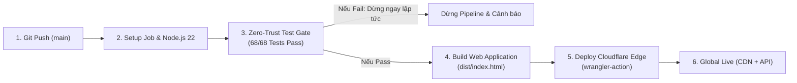

# Tài Liệu Thuyết Trình: CI/CD Pipeline & Zero-Trust Test Gate

Tài liệu này mô tả chi tiết kiến trúc, các bước thực thi và ý nghĩa kỹ thuật của pipeline **GitHub Actions** triển khai tự động lên **Cloudflare Workers Edge Network** cho dự án **Oops La Bookstore**.

---

## 1. Tổng quan Pipeline (Architecture & Execution Summary)

Pipeline được tối ưu hóa toàn diện với thời gian chạy trung bình **22 giây**, đảm bảo chuẩn **Zero-Trust**: chỉ khi 100% kịch bản kiểm thử vượt qua thì hệ thống mới được phép đóng gói và phát hành ra môi trường production.



### Chỉ số Hiệu năng Thực tế (Benchmark trên GitHub Runners)
- **Tổng thời gian chạy**: 22 giây.
- **Thời gian chạy Test**: ~2 giây (chạy song song toàn bộ 68 test).
- **Thời gian Build**: < 1 giây (Native zero-bundle build).
- **Thời gian Deploy Edge**: 15 giây (đồng bộ lên 300+ PoP toàn cầu của Cloudflare).

---

## 2. Chi tiết Từng Bước trong Workflow

| Bước (Step) | Thời gian | Mục đích kỹ thuật | Hành động cụ thể |
| :--- | :---: | :--- | :--- |
| **1. Set up job & Checkout** | 2s | Khởi tạo môi trường Ubuntu & kéo mã nguồn | Dùng `actions/checkout@v4`, clone working tree sạch sẽ. |
| **2. Setup Node.js 22** | 0s | Chuẩn bị runtime Node.js native mới nhất | Cài Node 22 hỗ trợ cờ native `--experimental-strip-types` (chạy TypeScript không cần build step cồng kềnh). |
| **3. Run Test Suite (Zero-Trust Gate)** | **2s** | **Cổng kiểm soát chất lượng & bảo mật** | Chạy `npm test`. Thực thi **68 kịch bản test** trên **17 test suites**. Nếu phát hiện bất kỳ lỗi hồi quy hay rò rỉ dữ liệu nào, job dừng ngay lập tức. |
| **4. Build Web Application** | 0s | Đóng gói tài sản tĩnh cho Edge | Chạy `npm run build`, đồng bộ mã nguồn giao diện chuẩn sang thư mục `dist/index.html`. |
| **5. Deploy to Cloudflare Workers** | 15s | Phát hành ra mạng lưới toàn cầu Cloudflare | Dùng `cloudflare/wrangler-action@v3` (Wrangler v4) đẩy Static Assets và API Edge Worker (`src/worker.ts`) lên Cloudflare. |

---

## 3. Phân tích Chuyên sâu: "Zero-Trust Test Gate" Kiểm tra những gì?

Bước kiểm thử không phải là test hình thức, mà là lá chắn bảo vệ toàn bộ tính toàn vẹn nghiệp vụ và bảo mật:

```text
68 Tests | 17 Test Suites | 0 Fail | Thời gian: 2.8s
```

### Nhóm 1: Kiểm thử Chống Gian Lận & Xung Đột Đơn Hàng (Concurrency & Fail-Closed)
- **V01 (Race Condition Prevention)**: Giả lập 2 yêu cầu cùng xác nhận cuốn sách độc bản cuối cùng trong kho cùng 1 mili-giây. Hệ thống khóa `AsyncLock` đảm bảo **chỉ 1 đơn thành công**, tuyệt đối không bị âm kho (overselling).
- **V02 (Fail-Closed Persistence)**: Khi ổ cứng hoặc DB gặp sự cố, hệ thống từ chối lưu đơn và báo lỗi ngay, không âm thầm nuốt lỗi làm mất tiền/đơn của khách.
- **R06 (Tamper Resistance)**: Khách hàng cố tình sửa giá tiền gửi lên từ trình duyệt sẽ bị server phát hiện và ép dùng giá gốc từ catalog.

### Nhóm 2: Kiểm thử Phân quyền Nghiêm ngặt (Dual-Role Permission Engine)
- **AC-11 (Staff Gate)**: Nhân viên (Staff) bị vô hiệu hóa nút Xác nhận đơn hàng (Chỉ Owner mới có quyền xác nhận).
- **OD-01 (Cancellation Guard)**: Nhân viên chỉ được hủy đơn chưa xác nhận; đơn đã duyệt chỉ Chủ tiệm (Owner) mới có quyền hủy.
- **OD-02 & AC-15 (Single Inventory Decrement)**: Trừ kho chính xác đúng 1 lần duy nhất khi chuyển trạng thái sang `CONFIRMED`.

### Nhóm 3: Kiểm thử Trải nghiệm & Nghiệp vụ Sách Kiến trúc
- **BD-04 (Zero Auto-Reservation)**: Khách gửi yêu cầu mua sách trên web **không được tự ý trừ kho** trước khi được Owner liên hệ tư vấn.
- **1:20 Blueprint Zoom**: Kiểm tra thuật toán Canvas Zoom Lens (phóng đại từ 1.0x đến 4.0x mà không vỡ bản vẽ kiến trúc Atelier Bow-Wow).
- **CURR-01 (Single Currency)**: Quét toàn bộ component giao diện, đảm bảo định dạng duy nhất `VNĐ`, loại bỏ hoàn toàn các ký hiệu ngoại tệ rác.

### Nhóm 4: Kiểm thử An ninh Mạng (Security Hardening)
- **Path Traversal Protection**: Chặn đứng các đòn tấn công mò file hệ thống (ví dụ: `GET /../../etc/passwd`).
- **XSS Sanitization**: Tự động mã hóa thẻ script độc hại trong tên khách hàng hoặc địa chỉ giao hàng (`escapeHtml`).
- **CSP Headers**: Thiết lập Content-Security-Policy chặt chẽ, chỉ cho phép load style và script từ domain hợp lệ.

---

## 4. Giá trị Đạt được Khi Báo cáo / Thuyết trình

Khi thuyết trình về hệ thống này với đối tác, khách hàng hoặc hội đồng kỹ thuật, có 4 luận điểm cốt lõi:

1. **Zero-Trust Delivery**: Code không thể lên production nếu không chứng minh được tính đúng đắn qua 68 bài kiểm tra tự động.
2. **Siêu tốc & Tiết kiệm (Serverless Edge)**: 
   - Không tốn chi phí thuê máy chủ hàng tháng.
   - Nhờ mạng lưới toàn cầu Cloudflare (300+ thành phố), thời gian tải trang dưới 50ms cho người dùng khắp Việt Nam và quốc tế.
3. **Độ ổn định tuyệt đối (Reliability)**: 
   - Tách biệt rạch ròi: Frontend tĩnh tải từ CDN, Backend Edge xử lý đơn hàng độc lập, không sợ sập server khi có lượng truy cập đột biến.
4. **Chuẩn hóa GitOps**: Mọi thay đổi đều được ghi vết trên Git, commit sạch, CI/CD tự động hoá 100%, loại bỏ hoàn toàn rủi ro thao tác tay.
