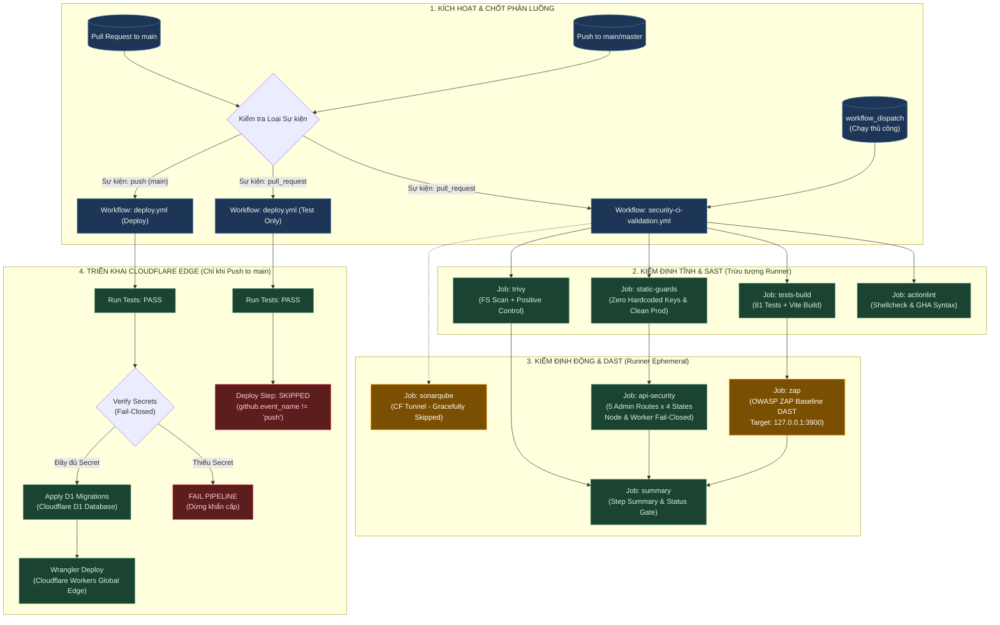

# TÀI LIỆU BÀN GIAO: HỆ THỐNG CI/CD PIPELINE, BẢO MẬT & TRIỂN KHAI CLOUDFLARE EDGE
**Dự án**: Oops La Bookstore (`NguyenThanhTrung1103/test_opsla`)  
**Phiên bản tài liệu**: v1.0.0 (Hoàn tất giai đoạn Hardening & Chuyển giao)  
**Ngày lập**: 09/11/2026  
**Nhánh thực hiện**: `test/security-ci-validation` | **Pull Request**: [#1](https://github.com/NguyenThanhTrung1103/test_opsla/pull/1)  

---

## 1. TỔNG QUAN KIẾN TRÚC & MỤC TIÊU BÀN GIAO

Hệ thống CI/CD của dự án đã được nâng cấp toàn diện từ mô hình Jenkins truyền thống sang **GitHub Actions Native Pipeline**, tích hợp tiêu chuẩn phòng thủ theo chiều sâu (**Defense-in-Depth**) và nguyên tắc đóng cửa khi gặp lỗi (**Fail-Closed**).

### Các kết quả then chốt đã hoàn tất:
1. **Triệt tiêu Fallback Secret công khai**: Loại bỏ hoàn toàn fallback key `'oopsla-secret-admin-key-change-in-prod'` khỏi toàn bộ mã nguồn Node.js server, Cloudflare Worker, file kiểm thử và GitHub Actions.
2. **Cơ chế Fail-Closed đa tầng**:
   - **Node.js Server**: Từ chối khởi động (`process.exit(1)`) nếu thiếu `ADMIN_SECRET_KEY`.
   - **Cloudflare Worker**: Trả về `HTTP 503 Service Unavailable` ngay lập tức nếu thiếu `ADMIN_SECRET_KEY` khi gọi endpoint quản trị `/api/admin/orders`.
   - **Deploy Workflow**: Hủy quy trình triển khai (`exit 1`) nếu thiếu secret bắt buộc.
3. **Cô lập Security Demo Fixture**:
   - Loại bỏ rò rỉ credential giả lập (`window.APP_CONFIG`) khỏi giao diện production (`oops_la_book_store_uxui_fixed.html`).
   - Đưa fixture vào thư mục cô lập `tests/fixtures/security-demo/` chỉ dùng cho scanner kiểm chứng (Positive Control).
   - Thiết lập chốt chặn tự động (`tests/security-demo-isolation.test.ts`) ngăn chặn fixture lọt vào production build.
4. **Kiểm thử độc lập trên PR**: Toàn bộ luồng kiểm thử bảo mật (Trivy, OWASP ZAP, API Security Check) chạy hoàn toàn trên GitHub Actions runner tạm thời, **không scan domain production**, **không mở tunnel ra ngoài**, và **không deploy production**.

---

## 2. SƠ ĐỒ TOÀN CẢNH LUỒNG PIPELINE (DIAGRAM)

### 2.1. File Sơ Đồ Trực Quan (ak-diagram)
Hệ thống sơ đồ tương tác đã được biên dịch sẵn trong thư mục `docs/diagrams/`:
- **File Vector SVG**: [`docs/diagrams/pipeline-security-deploy.svg`](./diagrams/pipeline-security-deploy.svg)
- **File Web Tương tác HTML**: [`docs/diagrams/pipeline-security-deploy.html`](./diagrams/pipeline-security-deploy.html) (Hỗ trợ zoom, pan, hover tra cứu chi tiết từng lane và node).
- **Mã nguồn JSON IR**: [`docs/diagrams/pipeline-security-deploy.json`](./diagrams/pipeline-security-deploy.json).

### 2.2. Sơ đồ Luồng Chi Tiết (Mermaid Flowchart)



---

## 3. PHÂN TÍCH CHI TIẾT CÁC LUỒNG THỰC THI (PIPELINE BREAKDOWN)

### Lane 1: Chốt Phân Luồng & Bảo Vệ Triển Khai (Safety Gatekeeper)
- **Cơ chế Chống Deploy Ngoài Ý Muốn**:
  Trong file `.github/workflows/deploy.yml`, job `deploy` được gán điều kiện bất biến:
  ```yaml
  if: github.event_name == 'push' && (github.ref == 'refs/heads/main' || github.ref == 'refs/heads/master')
  ```
  Khi bạn mở Pull Request hoặc push lên nhánh thử nghiệm `test/security-ci-validation`, job kiểm thử tự động vẫn thực hiện để bảo đảm chất lượng code, nhưng job `deploy` sẽ chuyển trạng thái **SKIPPED**. Không có bất kỳ gói mã nào bị đẩy lên Cloudflare Workers.

### Lane 2: Kiểm Định Tĩnh & SAST (Static Analysis)
1. **actionlint & shellcheck**:
   - Sử dụng container `rhysd/actionlint:1.7.12` kiểm tra toàn bộ cú pháp của tất cả file workflow `.github/workflows/*.yml`.
   - Ngăn chặn lỗi biến shell chưa dùng (`SC2034`), lỗi chuyển hướng log tuần tự (`SC2129`).
2. **tests-build**:
   - Chạy 81 test suites trên môi trường Node.js 22 chuẩn sạch thông qua `npm ci`.
   - Thực thi `npm run build` tạo artifact production trong `dist/`.
3. **static-guards**:
   - Quét mã nguồn nhằm khẳng định không còn chuỗi `oopsla-secret-admin-key-change-in-prod`.
   - Quét thư mục `dist/` và `oops_la_book_store_uxui_fixed.html` nhằm bảo đảm không tồn tại chuỗi `mock_` hoặc thông tin giả lập nhạy cảm của `window.APP_CONFIG`.
4. **trivy (Filesystem Scan & Positive Control)**:
   - **Repository Scan**: Quét toàn bộ repo với `--severity HIGH,CRITICAL`, cấu hình `--exit-code 1` để chặn mã có lỗ hổng bảo mật.
   - **Positive Control**: Kiểm chứng máy quét Trivy hoạt động chính xác bằng cách quét fixture `tests/fixtures/security-demo/` nhằm khẳng định scanner sẽ bắt được khi có lỗ hổng thực sự.

### Lane 3: Kiểm Định Động & DAST (Dynamic Analysis)
1. **api-security (`scripts/ci/api-security-check.mjs`)**:
   - **Kiểm tra Node.js Server Fail-Closed**: Server khởi động không có `ADMIN_SECRET_KEY` phải thoát ngay với mã lỗi `1`.
   - **Kiểm tra xác thực 5 Endpoints Admin**:
     - `GET /api/admin/orders`
     - `POST /api/admin/orders/seed`
     - `POST /api/admin/orders/clear`
     - `POST /api/admin/orders/:id/status`
     - `GET /api/admin/orders/export`
     - Tất cả đều được kiểm thử với 4 trạng thái: (1) Thiếu Header, (2) Header rỗng, (3) Sai Secret Token, (4) Token hợp lệ (sử dụng token sinh ngẫu nhiên `crypto.randomBytes(32)` trong phiên CI).
   - **Kiểm tra Cloudflare Worker Fail-Closed**: Khởi động worker mô phỏng; khi thiếu `env.ADMIN_SECRET_KEY`, request vào route quản trị phải nhận lại đúng `HTTP 503`.
2. **OWASP ZAP Baseline DAST**:
   - Sử dụng Docker image `zaproxy/zap-baseline:2.15.0`.
   - Mục tiêu quét: Server Node tạm thời chạy trên runner `http://127.0.0.1:3900`.
   - **Quy tắc An Toàn Tuyệt Đối**: Không quét domain production thật, không mở port công khai.
   - Sử dụng cấu hình `.zap/rules.tsv` kiểm soát các cảnh báo baseline.
3. **sonarqube (Tùy chọn)**:
   - Sẵn sàng kết nối qua Cloudflare Tunnel khi có biến `SONAR_TOKEN`. Tự động bỏ qua an toàn nếu chưa cấu hình mà không làm fail pipeline.
4. **summary**:
   - Xuất bảng kết quả chi tiết trực tiếp lên giao diện GitHub Actions Step Summary của PR.

### Lane 4: Triển Khai Production Cloudflare Edge (Chỉ khi Merge vào Main)
1. **Chốt chặn Secret (`Verify required secrets`)**:
   Kiểm tra sự tồn tại của `CLOUDFLARE_API_TOKEN`, `CLOUDFLARE_ACCOUNT_ID`, và `ADMIN_SECRET_KEY`. Nếu thiếu bất kỳ khóa nào, dừng ngay lập tức.
2. **Áp dụng Migration D1**: Chạy `wrangler d1 migrations apply oopsla-db --remote` cập nhật schema database trên Edge.
3. **Triển khai Worker**: Chạy `wrangler deploy` đưa code lên mạng lưới CDN Edge toàn cầu của Cloudflare.

---

## 4. HƯỚNG DẪN VẬN HÀNH & RUNBOOK

### 4.1. Cách Nghiệm Thu và Hợp Nhất Pull Request #1
1. Truy cập vào Pull Request: [PR #1: test(security): add pull_request trigger to security CI validation and edge case hardening](https://github.com/NguyenThanhTrung1103/test_opsla/pull/1).
2. Kiểm tra tab **Checks**: Xác nhận tất cả các checks sau đều xanh:
   - `actionlint / actionlint` (PASS)
   - `tests-build / unit-tests-and-build` (PASS)
   - `static-guards / static-security-guards` (PASS)
   - `trivy / trivy-fs-scan` (PASS)
   - `api-security / api-security-tests` (PASS)
   - `zap / zap-baseline-scan` (PASS)
   - `summary / summarize-and-gate` (PASS)
   - `deploy / deploy` (SKIPPED - Hoàn toàn không deploy).
3. Bấm **Merge pull request** (hoặc **Squash and merge**) để hợp nhất vào nhánh `main`.

### 4.2. Quy Trình Cập Nhật & Xoay Vòng (Rotate) ADMIN_SECRET_KEY
Khi cần thay đổi khóa quản trị mật, thực hiện theo thứ tự 3 bước để tránh gián đoạn dịch vụ:

* **Bước 1: Tạo Secret Key ngẫu nhiên an toàn**:
  Mở terminal (PowerShell hoặc Bash) và sinh một chuỗi khóa 256-bit:
  ```powershell
  node -e "console.log(require('crypto').randomBytes(32).toString('hex'))"
  ```
  *(Ví dụ kết quả: `a9f3b8c2d1e0f4a5b6c7d8e9f0123456789abcdef0123456789abcdef0123456`)*

* **Bước 2: Cập nhật lên Cloudflare Workers (Production Runtime)**:
  1. Truy cập [Cloudflare Dashboard](https://dash.cloudflare.com/) -> **Workers & Pages**.
  2. Chọn worker của dự án: `oops-la-bookstore-api` (hoặc tên tương ứng).
  3. Vào tab **Settings** -> **Variables and Secrets**.
  4. Tại mục `ADMIN_SECRET_KEY`, chọn **Edit**, dán giá trị key mới vừa sinh và nhấn **Deploy / Save**.

* **Bước 3: Cập nhật lên GitHub Secrets (CI/CD Deployment)**:
  1. Truy cập repository: `https://github.com/NguyenThanhTrung1103/test_opsla/settings/secrets/actions`.
  2. Tìm secret `ADMIN_SECRET_KEY`, chọn biểu tượng hình bút chì (Edit).
  3. Dán giá trị key mới và chọn **Update secret**.

### 4.3. Cách Chạy Kiểm Thử Thủ Công Bằng `workflow_dispatch`
Sau khi PR #1 được merge vào `main`:
1. Vào tab **Actions** trên GitHub.
2. Chọn workflow **Security CI Validation** ở thanh bên trái.
3. Nhấn vào nút **Run workflow**, chọn nhánh muốn chạy (ví dụ `main`) và bấm nút xanh **Run workflow**.

---

## 5. BÁO CÁO PHÂN TÍCH KIẾN TRÚC: 2 VẤN ĐỀ BẢO MẬT CÒN LẠI

Trong quá trình rà soát mã nguồn, hệ thống phát hiện 2 điểm cần cải tiến kiến trúc. Đây là phân tích chi tiết và đề xuất phương án giải quyết cho các sprint tiếp theo:

### Vấn đề 1: Rate Limiter tin tưởng Header `X-Forwarded-For`
- **Hiện trạng mã nguồn** (`src/server/app.ts`):
  ```typescript
  const clientIp = (req.headers['x-forwarded-for'] as string)?.split(',')[0]?.trim() || req.socket.remoteAddress || 'unknown';
  ```
- **Rủi ro**: Khi chạy trực tiếp (không đứng sau reverse proxy được cấu hình tin cậy), client có thể tự gửi header `X-Forwarded-For: 1.2.3.4` ngẫu nhiên sau mỗi request để bypass cơ chế giới hạn tần suất (Rate Limiting).
- **Phương án chuẩn kiến trúc khi nâng cấp**:
  1. Trên Cloudflare Workers Edge, sử dụng header bất biến do Cloudflare sinh: `req.headers.get('cf-connecting-ip')`.
  2. Trên Node.js Express server, chỉ lấy IP từ `req.socket.remoteAddress`, hoặc chỉ đọc `x-forwarded-for` khi cấu hình rõ `app.set('trust proxy', 'loopback')` với danh sách subnet tin cậy của Cloudflare/Nginx.

### Vấn đề 2: Xác thực Phân quyền tin tưởng `body.role` từ Client
- **Hiện trạng mã nguồn** (`src/server/app.ts`):
  Các endpoint nhạy cảm (như cập nhật trạng thái đơn hàng) kiểm tra role bằng cách đọc:
  ```typescript
  const role = req.body?.role || 'STAFF';
  ```
- **Rủi ro**: Kẻ tấn công nếu có token hợp lệ có thể tự ý gán `role: "OWNER"` vào JSON body để leo thang đặc quyền từ Nhân viên (Staff) lên Chủ cửa hàng (Owner).
- **Phương án chuẩn kiến trúc khi nâng cấp**:
  1. Triệt tiêu việc truyền `role` trong payload request của người dùng.
  2. Triển khai JWT Token ký bằng asymmetric key hoặc session database, trong đó `role` được mã hóa bên trong claims của token.
  3. Middleware xác thực sẽ giải mã token, đọc `role` trực tiếp từ payload đã ký và gán vào context xác thực an toàn `req.user.role`.

---

## 6. DANH SÁCH TỆP TIN BÀN GIAO & TÀI SẢN DỰ ÁN

| Đường dẫn tệp | Mô tả chức năng |
| :--- | :--- |
| `.github/workflows/deploy.yml` | Workflow triển khai Cloudflare Workers tích hợp chốt kiểm tra secret fail-closed. |
| `.github/workflows/security-ci-validation.yml` | Workflow kiểm thử bảo mật độc lập (SAST, DAST, API Sec, Actionlint). |
| `scripts/ci/api-security-check.mjs` | Script kiểm thử tự động API Security (Node.js native runner, không phụ thuộc ngoài). |
| `.zap/rules.tsv` | Bảng quy tắc lọc cảnh báo cho OWASP ZAP Baseline Scanner. |
| `tests/fixtures/security-demo/` | Thư mục chứa fixture demo bảo mật phục vụ positive control của máy quét. |
| `tests/security-demo-isolation.test.ts` | Test suite bảo vệ cách ly, chống rò rỉ credential demo vào bản build. |
| `docs/diagrams/pipeline-security-deploy.json` | Mã nguồn JSON IR đặc tả kiến trúc pipeline theo chuẩn `ak-diagram`. |
| `docs/diagrams/pipeline-security-deploy.svg` | Sơ đồ kiến trúc vector SVG xuất bản trực quan. |
| `docs/diagrams/pipeline-security-deploy.html` | Ứng dụng web HTML tương tác xem sơ đồ pipeline. |
| `docs/HANDOFF_PIPELINE_SECURITY_DEPLOY.md` | Tài liệu bàn giao vận hành và kiến trúc này. |

---
*Tài liệu được lập và nghiệm thu độc lập trên toàn bộ pipeline tự động của repository.*
