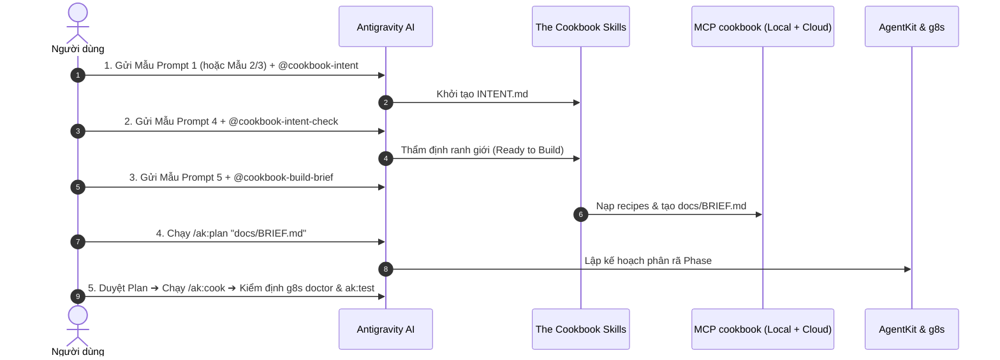

# THE COOKBOOK UNIVERSAL PLAYBOOK
## Tài Liệu Chuẩn Hóa & Bộ Prompts Thực Chiến Dùng Cho Mọi Dự Án
*(Dành riêng cho Google Antigravity `agy` + AgentKit trên Windows)*

---

## I. Phân Định Ranh Giới Kiến Trúc (Architecture Boundaries)

Khi áp dụng vào bất kỳ dự án nào (mới hoặc cũ), hệ thống được phân định rõ ràng thành 4 trụ cột độc lập, không giẫm chân lên nhau:

```
┌────────────────────────────────────────────────────────────────────────┐
│ 1. GLOBAL CONSTITUTION & SPEC KIT (SSOT)                               │
│    • Luật tối cao, nguyên tắc bất biến (Invariants), Model Routing.     │
├────────────────────────────────────────────────────────────────────────┤
│ 2. REPOSITORY HARNESS & AI MEMORY                                      │
│    • Kế hoạch bền vững (docs/plans/), nhật ký kỹ thuật (Journal.md),   │
│      bàn giao ca trực (handoff.md), bảng nghiệm thu (TEST_MATRIX.md).  │
├────────────────────────────────────────────────────────────────────────┤
│ 3. ZERO-TRUST GATEKEEPER (g8s)                                         │
│    • Soi 11 anti-patterns, chặn TDD Trap (test pass ảo, bịa code).     │
├────────────────────────────────────────────────────────────────────────┤
│ 4. THE COOKBOOK SKILLS & MCP (DOMAIN ENGINE - ĐÃ ĐÓNG GÓI TOÀN CỤC)     │
│    • Bộ 5 Skills: Chốt quyết định ➔ Ý định ➔ Thẩm định ➔ Bàn giao.    │
│    • MCP Server Hybrid: Tra cứu 6 công thức gốc + Tự động Sync Cloud.  │
└────────────────────────────────────────────────────────────────────────┘
```

> **Nguyên tắc vàng:** The Cookbook là **Domain Engine** (cung cấp bản thiết kế nghiệp vụ chuẩn: auth, payment, booking, crm, docs, email). Spec Kit giữ **Luật**, Harness giữ **Quy trình**, g8s giữ **Chất lượng code**.

---

## II. Danh Mục 5 Skills Cookbook Toàn Cục & Cú Pháp Kích Hoạt

Toàn bộ 5 skills này đã được đóng gói toàn cục tại `C:\Users\nguyen.thanh-trung9\.gemini\config\skills\`. Bạn có thể kích hoạt ở **bất kỳ thư mục dự án nào**:

| Skill | Lệnh Slash | Cú pháp Prompt Mention | Vai trò cốt lõi |
|---|---|---|---|
| **Setup & MCP** | `/cookbook-setup` | `Dùng skill cookbook-setup kiểm tra MCP...` | Kiểm tra kết nối token, nạp cấu hình MCP The Cookbook. |
| **Intent Studio** | `/cookbook-intent` | `Dùng skill cookbook-intent chuyển ý tưởng thành INTENT.md...` | Chuyển bài toán thành bản ý định 1 trang chuẩn schema `intent/v1`. |
| **Thanh tra Ý định** | `/cookbook-intent-check` | `Dùng skill cookbook-intent-check thẩm định INTENT.md...` | Quét lỗ hổng, phát hiện đoán mò, kiểm tra tiêu chí Done quan sát được. |
| **Tra cứu công thức** | `/cookbook-recipes` | `Dùng skill cookbook-recipes tra cứu công thức [X]...` | Đọc 6 recipes gốc (`auth-roles`, `booking`, `crm`, `documents`, `email`, `payments`). |
| **Bàn giao Build** | `/cookbook-build-brief` | `Dùng skill cookbook-build-brief tạo docs/BRIEF.md...` | Đóng gói `INTENT.md` + copy recipes tương ứng ➔ tạo hồ sơ `docs/BRIEF.md`. |

---

## III. Bộ Prompt Chuẩn (Master Prompt Pack)

Dưới đây là các mẫu prompt chuẩn hóa được thiết kế sẵn. Bạn chỉ cần sao chép, điền thông tin và gửi cho Antigravity:

---

### MẪU 1: Khởi động Dự Án Mới (Khi Chưa Có BRD - Chỉ Có Ý Tưởng)

> **Mục tiêu:** Kích hoạt Intent Studio để trả lời 5 câu hỏi quyết định và tạo `INTENT.md`.

```text
Dùng skill cookbook-intent để giúp mình khởi động dự án mới.

Ý tưởng bài toán:
[Mô tả ngắn gọn ý tưởng của bạn: ai dùng, họ gặp khó khăn gì, giải pháp mong muốn là gì]

Hãy đóng vai trò Intent Studio của The Cookbook:
1. Hỏi mình tối đa 3-5 câu hỏi quyết định cốt lõi: Khách hàng là ai, họ đổi tiền lấy gì, điều gì làm tự động vs làm thủ công, và điều cấm kỵ (Invariants) tuyệt đối không được xảy ra.
2. Từ câu trả lời, hãy soạn thảo file INTENT.md chuẩn schema intent/v1 tại thư mục gốc.
3. Không tự suy diễn mở rộng phạm vi (Zero Scope Drift). Chưa viết code.
```

---

### MẪU 2: Khởi động Khi Đã Có Sẵn Tài Liệu BRD / Spec Nghiệp Vụ

> **Mục tiêu:** Trích xuất luật bất biến và chuyển đổi BRD thành `INTENT.md` chuẩn hóa.

```text
Dùng skill cookbook-intent để chuẩn hóa tài liệu BRD cho dự án.

Đường dẫn tài liệu BRD: [Đường dẫn file BRD, ví dụ: docs/BRD.md hoặc path/to/spec.md]

Nhiệm vụ:
1. Đọc và trích xuất: Mục tiêu kinh doanh, các actors, quy tắc bất biến bắt buộc (Invariants), và phạm vi MVP.
2. Ghi rõ danh sách Out-of-Scope (những gì tuyệt đối KHÔNG làm ở giai đoạn này).
3. Ánh xạ các chức năng vào 6 công thức gốc của The Cookbook (auth-roles, booking, crm, documents, email, payments).
4. Tạo bản ý định INTENT.md theo chuẩn schema intent/v1.
```

---

### MẪU 3: Khởi động Khi Đã Có Bản Thiết Kế UX/UI (Mockup / Figma / HTML Wireframe)

> **Mục tiêu:** Tách biệt giao diện và logic dữ liệu, định nghĩa tiêu chí nghiệm thu thị giác.

```text
Dùng skill cookbook-intent để phân tích bản thiết kế UX/UI cho dự án.

Đường dẫn thiết kế/mockup: [Đường dẫn file HTML mẫu, Figma export hoặc ảnh chụp]

Nhiệm vụ:
1. Tách biệt tầng hiển thị (Presentation) và quy tắc nghiệp vụ ngầm (Domain Rules).
2. Xác định các trạng thái giao diện bắt buộc cho từng màn hình: Empty State, Loading, Success, Error / Blocked.
3. Soạn thảo INTENT.md với các tiêu chí nghiệm thu quan sát được (Visual Acceptance Criteria) bám sát các màn hình này.
```

---

### MẪU 4: Thẩm Định Bản Ý Định (Bắt Buộc Chạy Trước Khi Lập Kế Hoạch)

> **Mục tiêu:** Đóng vai thanh tra The Cookbook, tìm lỗ hổng trước khi tốn token viết code.

```text
Dùng skill cookbook-intent-check để kiểm tra toàn diện file INTENT.md vừa tạo.

Yêu cầu kiểm tra:
1. Phát hiện các giá trị bị đoán mò (guessed values).
2. Kiểm tra xem các tiêu chí Done có quan sát được bằng mắt hoặc kiểm chứng được bằng test không.
3. Xác nhận xem các công thức Cookbook được chọn đã đủ và đúng chưa.
4. Trả về kết luận rõ ràng: READY TO BUILD hoặc NEEDS REVISION (kèm hướng dẫn sửa cụ thể).
```

---

### MẪU 5: Bàn Giao Xây Dựng (Sinh `docs/BRIEF.md` & Copy Recipes)

> **Mục tiêu:** Chuyển giao sang giai đoạn lập kế hoạch `ak:plan`.

```text
File INTENT.md đã được duyệt. Hãy dùng skill cookbook-build-brief để bàn giao sang giai đoạn xây dựng:

1. Tự động sao chép các file công thức tương ứng từ The Cookbook vào docs/cookbook/.
2. Tạo hồ sơ nhiệm vụ docs/BRIEF.md khóa chặt Invariants, ranh giới và kịch bản kiểm thử.
3. Sau khi tạo xong BRIEF.md, hãy đề xuất lệnh lập kế hoạch ak:plan phù hợp.
```

---

### MẪU 6: Kiểm Tra & Đồng Bộ Công Thức Mới Nhất Từ Cloud MCP (Online Sync)

> **Mục tiêu:** Đảm bảo không dùng tài liệu cũ, luôn cập nhật các bài học và lưu ý mới từ máy chủ tác giả.

```text
Hãy gọi MCP cookbook để kiểm tra bản mới nhất (latest) của công thức [tên công thức: payments / auth-roles / booking / crm...] trên máy chủ mcp.arealisticdreamer.com.

Yêu cầu:
1. Sử dụng token tại C:\Users\nguyen.thanh-trung9\.gemini\config\ard-token.json để đồng bộ với Cloud.
2. Đối chiếu xem có bài học, cập nhật bẫy (Traps) hoặc Invariants mới nào từ Tony không.
3. Báo cáo các điểm mới cần chú ý trước khi áp dụng vào mã nguồn dự án hiện tại.
```

---

## IV. Quy Trình 5 Bước Thực Hiện Trên Dự Án Mới (Step-by-Step Runbook)

Khi bạn mở một thư mục dự án mới trong Antigravity, chỉ cần làm đúng 5 bước:



1. **Bước 1: Chốt Ý định**: Gửi **Mẫu Prompt 1, 2 hoặc 3** để sinh `INTENT.md`.
2. **Bước 2: Thẩm định**: Gửi **Mẫu Prompt 4** (`cookbook-intent-check`) để đạt trạng thái `READY TO BUILD`.
3. **Bước 3: Bàn giao**: Gửi **Mẫu Prompt 5** (`cookbook-build-brief`) để sinh `docs/BRIEF.md` và nạp recipes vào `docs/cookbook/`.
4. **Bước 4: Lập kế hoạch**: Chạy `/ak:plan "docs/BRIEF.md"` để phân rã các Phase (Foundation ➔ Domain ➔ UI ➔ Workflow ➔ Verification).
5. **Bước 5: Lập trình & Kiểm thử**: Chạy `/ak:cook` theo chuẩn TDD, sau đó quét chất lượng bằng `g8s doctor --anti-pattern-catalog` và `/ak:test optimize --ultra`.

---

## V. Xử Lý Sự Cố & Câu Hỏi Thường Gặp (Troubleshooting)

| Tình huống | Nguyên nhân | Cách khắc phục ngay |
|---|---|---|
| AI báo `Skill unavailable` | Chưa nhận diện tên skill | Gõ đúng tên skill: `cookbook-intent`, `cookbook-intent-check`, `cookbook-recipes`, `cookbook-build-brief`, `cookbook-setup`. |
| MCP báo `401 Unauthorized` | Token Cloud hết hạn | Chạy script tự động refresh: Token lưu tại `~/.gemini/config/ard-token.json`, hệ thống sẽ tự dùng `refresh_token` lấy lại token mới trong 1 giây. |
| AI tự ý viết code quá sớm | Bỏ qua bước lập Brief | Yêu cầu AI: *"Dừng lại, tuân thủ Tri-Pillar: Cần hoàn tất Gate INTENT và BRIEF.md trước khi viết code."* |
| Cần dùng offline hoàn toàn | Không có mạng Internet | Máy chủ MCP `cookbook` tự động đọc từ thư mục fallback cục bộ với đầy đủ 6 công thức gốc, không cần mạng. |
