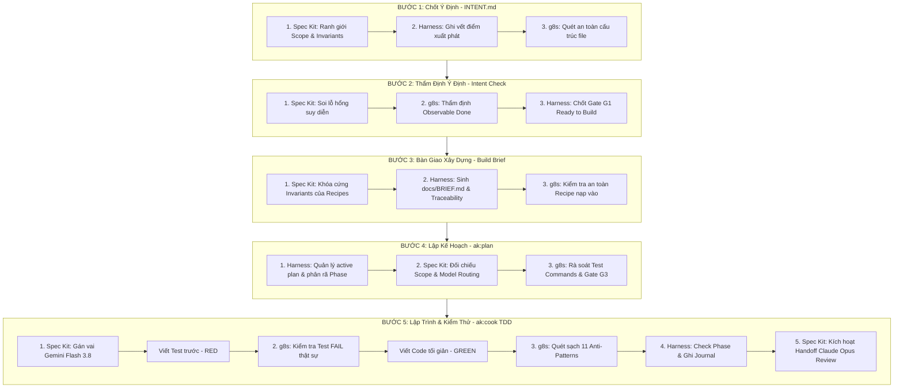

# Cơ Chế Phối Hợp: Spec Kit + Repository Harness + g8s Gatekeeper Xuyên Suốt 5 Bước The Cookbook

> Tài liệu phân tích chuyên sâu về cơ chế kiểm soát, thứ tự ưu tiên và danh mục kiểm tra của **Bộ 3 Trụ Cột (Tri-Pillar Governance)** tại từng mắt xích trong chu trình The Cookbook.

---

## I. Ma Trận Vai Trò Cốt Lõi Của 3 Trụ Cột

| Trụ Cột | Bản chất | Thẩm quyền tối cao | Nhiệm vụ chính tại các chốt chặn (Gates) |
|---|---|---|---|
| **1. Spec Kit** | **Hiến pháp (SSOT)** | Giám sát tính hợp hiến & Ranh giới | Kiểm tra thứ bậc thẩm quyền, chống suy diễn mở rộng phạm vi (Zero Scope Drift), bảo vệ Invariants, điều phối Model Routing. |
| **2. Repository Harness** | **Vòng đời & Bộ nhớ (Lifecycle Governor)** | Giám sát trạng thái & Tiến trình | Quản lý kế hoạch duy nhất (`docs/plans/active/`), kiểm soát chuyển giao ca trực (`handoff.md`), ghi vết kỹ thuật (`Journal.md`), nghiệm thu (`TEST_MATRIX.md`). |
| **3. g8s Gatekeeper** | **Thanh tra cơ học (Mechanical Zero-Trust)** | Kiểm định chất lượng code & test | Soi 11 Anti-Patterns kinh điển, bẫy test pass ảo (`--tdd-trap-check`), cô lập môi trường và bảo vệ an toàn execution. |

---

## II. Phân Tích Chi Tiết 5 Bước: Ai Check? Check Gì? Thứ Tự Ra Sao?



---

### BƯỚC 1: Chốt Ý Định (`cookbook-intent` ➔ `INTENT.md`)

* **Mục tiêu**: Chuyển bài toán/BRD/mockup thành bản ý định 1 trang chuẩn schema `intent/v1`.
* **Thứ tự kiểm tra**:
  1. **Spec Kit (Kiểm tra đầu tiên)**:
     - *Check gì*: Soát xét các phát biểu trong ý tưởng so với Hiến pháp (`constitution.md`). Đảm bảo không vi phạm các cấm kỵ cốt lõi (ví dụ: không bypass xác thực, không can thiệp trái phép, bảo vệ quyền riêng tư).
     - *Cách check*: Phân loại rõ: Quyết định của người dùng (User Decisions) vs. Giả định của AI (Assumptions). Cắt bỏ mọi suy diễn ngoài phạm vi MVP (Zero Scope Drift).
  2. **Repository Harness (Kiểm tra thứ hai)**:
     - *Check gì*: Kiểm tra tính duy nhất của tài liệu. Đảm bảo chưa có kế hoạch active nào đang xung đột.
     - *Cách check*: Ghi nhận trạng thái khởi động dự án vào `docs/ai-memory/Journal.md` và khởi tạo `docs/PROJECT_BOOTSTRAP_STATUS.md`.
  3. **g8s Gatekeeper (Kiểm tra thứ ba)**:
     - *Check gì*: Đảm bảo file `INTENT.md` không chứa hardcoded secrets (API keys, token, mật khẩu thật), tuân thủ định dạng markdown an toàn.

---

### BƯỚC 2: Thẩm Định Bản Ý Định (`cookbook-intent-check`)

* **Mục tiêu**: Đóng vai thanh tra phản biện, phát hiện lỗ hổng trước khi tốn token lập trình.
* **Thứ tự kiểm tra**:
  1. **Spec Kit (Kiểm tra tính hợp hiến & Invariants)**:
     - *Check gì*: Kiểm tra xem có mục nào vi phạm nguyên tắc "Fail Closed" không? Các luật bất biến (ví dụ: tiền tệ, quyền hủy đơn, trừ kho) đã được mô tả ở cấp bất khả xâm phạm chưa?
     - *Cách check*: Quét từng dòng trong `INTENT.md`, phát hiện các từ khóa mập mờ ("có thể", "tùy chọn", "sau này tính").
  2. **g8s Gatekeeper (Thẩm định tính khả chứng cơ học)**:
     - *Check gì*: Tiêu chí hoàn thành (Done) có thực sự **quan sát được bằng mắt** hoặc **chứng minh được bằng test** không?
     - *Cách check*: Chặn đứng các tiêu chí cảm tính như "hệ thống chạy mượt", "giao diện đẹp". Bắt buộc chuyển thành hành vi cơ học: "Khi click X thì hiển thị Y", "Khi gửi dữ liệu rỗng thì trả về mã lỗi 400".
  3. **Repository Harness (Khóa chốt chặn Gate G1)**:
     - *Check gì*: Bản ý định đã sẵn sàng chưa?
     - *Cách check*: Nếu có bất kỳ điểm nào chưa đạt, gán trạng thái `NEEDS_REVISION` và dừng lại. Chỉ khi tất cả pass mới cấp quyền `READY TO BUILD` chuyển sang Bước 3.

---

### BƯỚC 3: Bàn Giao Xây Dựng (`cookbook-build-brief` ➔ `docs/BRIEF.md`)

* **Mục tiêu**: Khóa chặt hợp đồng nhiệm vụ và sao chép các công thức Cookbook tương ứng vào dự án.
* **Thứ tự kiểm tra**:
  1. **Spec Kit (Kiểm tra thẩm quyền công thức)**:
     - *Check gì*: Công thức được chọn (`auth-roles`, `payments`, `booking`...) có phù hợp và đủ với ranh giới của `INTENT.md` không? Có bị thừa tính năng (over-engineering) không?
     - *Cách check*: Khóa cứng các Invariants của từng công thức vào `docs/BRIEF.md`. Cấm hạ chuẩn bảo mật (ví dụ: `auth-roles` bắt buộc fail-closed; `payments` cấm dùng số thực `float`).
  2. **Repository Harness (Tạo hồ sơ và truy vết Traceability)**:
     - *Check gì*: Hồ sơ dự án đã hoàn chỉnh chưa?
     - *Cách check*: Tạo `docs/BRIEF.md`, thiết lập bảng `docs/RECIPE_TRACEABILITY.md`, lưu vết liên kết nguồn gốc công thức (local/cloud), ghi nhật ký vào `docs/ai-memory/Journal.md`.
  3. **g8s Gatekeeper (Quét mã độc / Script injection)**:
     - *Check gì*: Các tệp workbook được nạp vào `docs/cookbook/` có chứa đoạn mã độc, lệnh shell nguy hiểm hay backdoor không?
     - *Cách check*: Quét an toàn toàn bộ nội dung markdown và schema imported.

---

### BƯỚC 4: Lập Kế Hoạch Phân Rã Phase (`/ak:plan "docs/BRIEF.md"`)

* **Mục tiêu**: Phân rã kiến trúc thành các Phase thực thi tuần tự (Foundation ➔ Domain ➔ UI ➔ Workflow ➔ Verification).
* **Thứ tự kiểm tra**:
  1. **Repository Harness (Quản trị cấu trúc Plan - Rule 1 Active Plan)**:
     - *Check gì*: Tuân thủ quy tắc chỉ có DUY NHẤT một file kế hoạch active tại `docs/plans/active/<slug>.md`.
     - *Cách check*: Kiểm tra tính tuần tự của các phase, danh sách file ownership (file nào phase nào sửa, không giẫm chân nhau), tiêu chuẩn nghiệm thu từng phase.
  2. **Spec Kit (Đối chiếu Hiến pháp & Model Routing)**:
     - *Check gì*: Kế hoạch có bám sát 100% `docs/BRIEF.md` không (chống Scope Creep trong quá trình AI lập plan)? Các phase có gán đúng vai model không?
     - *Cách check*: Soát xét từng task trong plan. Chỉ định: Gemini Flash 3.8 cho TDD coding; Claude Opus 5.5 cho Review.
  3. **g8s Gatekeeper (Thanh tra câu lệnh kiểm thử cơ học)**:
     - *Check gì*: Mỗi task hoặc phase bắt buộc phải có câu lệnh kiểm thử cụ thể (Command Verification), không chấp nhận plan chỉ nói suông.
     - *Cách check*: Kiểm tra sự hiện diện của `npm test`, test file path, assertion target. Nếu thiếu test command ➔ Báo lỗi plan không hợp lệ.
  4. **Chốt chặn Gate G3 (User Plan Approval)**:
     - *Harness dừng lại*: Bắt buộc người dùng trả lời `APPROVE PLAN` mới được chuyển sang Bước 5. Tuyệt đối không tự ý cook khi chưa có lệnh.

---

### BƯỚC 5: Lập Trình Thực Thi & Kiểm Định (`/ak:cook` + TDD + Review)

Đây là bước diễn ra sự phối hợp liên tục, chặt chẽ nhất giữa cả 3 trụ cột theo chu trình **Red ➔ Green ➔ Refactor ➔ Review**:

```
[1. Spec Kit: Phân vai Flash 3.8]
       ↓
[2. Coding Worker: Viết Test trước (RED)]
       ↓
[3. g8s: Chạy --tdd-trap-check (Bảo đảm Test FAIL thật)]
       ↓
[4. Coding Worker: Viết Code tối giản (GREEN)]
       ↓
[5. g8s: Chạy --anti-pattern-catalog (Soi 11 lỗi lập trình AI)]
       ↓
[6. Harness: Đánh dấu hoàn thành Task & Ghi Journal.md]
       ↓
[7. Spec Kit: Kích hoạt Handoff yêu cầu đổi sang Claude Opus Reviewer]
       ↓
[8. Claude Opus: Độc lập kiểm tra Invariants, Security, Edge Cases]
       ↓
[9. Harness: Đóng Plan completed & Cập nhật TEST_MATRIX.md]
```

#### Chi tiết kiểm tra của từng trụ cột ở Bước 5:

1. **g8s Gatekeeper (Thanh tra cơ học liên tục)**:
   * **Bẫy TDD (`g8s doctor --tdd-trap-check`)**:
     - Test có chạy thật không hay chỉ in dòng chữ pass ảo?
     - Test có FAIL trước khi viết code không? (Ngăn chặn test luôn luôn PASS dù code đúng hay sai).
     - Test có phụ thuộc vào symbol bịa đặt (import ảo không tồn tại) không?
   * **11 Lỗi lập trình AI (`g8s doctor --anti-pattern-catalog`)**:
     - *AP-01*: Mock dữ liệu quá mức làm mất tính chân thực.
     - *AP-02*: Tạo file rác hoặc symbol không có ai gọi.
     - *AP-03*: Lộ secret, token hoặc API key trong code/test.
     - *AP-04*: Dùng số thực `float` (`19.99`, `parseFloat`) cho tiền tệ (bắt buộc dùng số nguyên đồng).
     - *AP-05*: Thiếu kiểm tra điều kiện biên (mảng rỗng, null, số âm).
     - *AP-06*: Try-catch nuốt lỗi ngầm (silent error swallowing).
     - *AP-07*: Lệch pha giữa TypeScript domain types và dữ liệu lưu trữ.
     - *AP-08*: Bỏ qua rào cản phân quyền (Staff gọi được hàm của Admin).
     - *AP-09*: Ép kiểu vô căn cứ (`as any`, `unknown as T`).
     - *AP-10*: Test này làm thay đổi dữ liệu của test khác (State leak).
     - *AP-11*: Bất đồng bộ không an toàn gây xung đột dữ liệu (Race condition).

2. **Repository Harness (Quản trị trạng thái và bằng chứng)**:
   * *Trước khi hoàn tất phase*: Đòi hỏi **Observable / Executable Evidence** (kết quả test thực tế trong terminal, logs `PASS`, thời gian chạy).
   * *Ghi chép bền vững*: Tự động cập nhật `docs/ai-memory/Journal.md` với lý do kỹ thuật (WHY); cập nhật `docs/TEST_MATRIX.md`.
   * *Khi hoàn thành toàn bộ*: Chuyển file kế hoạch từ `docs/plans/active/` sang `docs/plans/completed/`.

3. **Spec Kit (Bảo vệ tính độc lập và Model Routing)**:
   * *Quy định bàn giao (Handoff)*: Coding worker (Gemini Flash 3.8) không được phép tự đóng vai Reviewer.
   * *Chốt chặn Review*: Spec Kit phát tín hiệu `MODEL_SWITCH_REQUIRED` kèm **Review Packet** yêu cầu người dùng chuyển sang Claude Opus 5.5 để thẩm định độc lập.
   * *Fallback rule*: Chỉ cho phép dùng Flash review nội bộ khi có bằng chứng kiệt quota Opus, và bắt buộc ghi rõ nhãn "Review nội bộ - không độc lập".

---

## III. Bảng Tổng Hợp Kiểm Tra Nhanh

| Bước Cookbook | Trụ Cột Nắm Quyền Chính | Chốt Chặn Bắt Buộc | Lệnh / Công Cụ Kiểm Tra |
|---|---|---|---|
| **1. Intent** | Spec Kit | Không suy diễn scope ngoài bài toán | Soát xét schema `intent/v1` |
| **2. Intent Check**| g8s + Spec Kit | Done phải quan sát/đo lường được | `/cookbook-intent-check` |
| **3. Build Brief** | Spec Kit + Harness | Khóa cứng Invariants của Recipes | `/cookbook-build-brief` |
| **4. Plan** | Harness + Spec Kit | Duy nhất 1 plan active, có test command | `/ak:plan` + Gate G3 Approval |
| **5. Cook & Test** | g8s + Spec Kit + Harness | 0 anti-pattern, 0 test ảo, Review độc lập | `g8s doctor`, `npm test`, Handoff |
