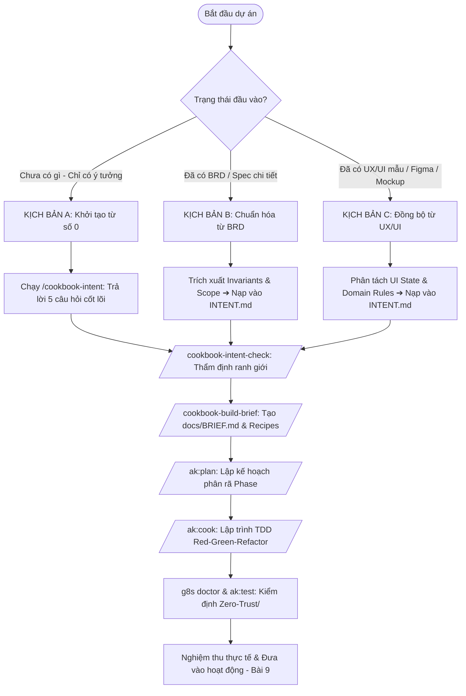

# Hướng Dẫn Thực Chiến: Quy Trình Phát Triển Ứng Dụng Với The Cookbook & AgentKit

> **Tài liệu tham chiếu chuẩn:** Gốc từ `The Cookbook v1.0.5` (10 bài hướng dẫn thực hành tại `the-cookbook-v1.0.5/guide/`) kết hợp cùng hệ thống kỹ năng **AgentKit**, **Spec Kit** và cơ chế bảo vệ **Zero-Trust (g8s)** trên môi trường **Antigravity (`agy`)**.

---

## I. Tổng Quan Về Phương Pháp Luận The Cookbook

Triết lý cốt lõi của The Cookbook gói gọn trong 6 mắt xích:
```
[1. Quyết định] ➔ [2. Ý định] ➔ [3. Công thức] ➔ [4. Xây dựng] ➔ [5. Kiểm định / Tự lái] ➔ [6. Ship]
```

Thay vì nhảy vào viết code ngay (dễ dẫn đến lan man, code rác và ảo giác AI), The Cookbook buộc quy trình phải đi qua **bản ý định 1 trang (`INTENT.md`)** với các **luật bất biến (Invariants)** được định nghĩa rõ ràng trước khi giao cho AI thực thi.

### Các Kỹ Năng (Skills) Cookbook Đã Nạp Trong Workspace

| Skill | Lệnh / Kích hoạt | Vai trò trong chu trình |
|---|---|---|
| **cookbook-setup** | `/cookbook-setup` | Quản lý kết nối MCP, kiểm tra môi trường và đồng bộ hệ thống. |
| **cookbook-intent** | `/cookbook-intent` | Kích hoạt Intent Studio: chuyển hóa ý tưởng thành `INTENT.md` chuẩn schema `intent/v1`. |
| **cookbook-intent-check** | `/cookbook-intent-check` | Thanh tra `INTENT.md`: tìm lỗ hổng, dữ liệu suy diễn, tiêu chí hoàn thành mơ hồ. |
| **cookbook-recipes** | `/cookbook-recipes` | Tra cứu 6 công thức gốc (`auth-roles`, `booking`, `crm`, `documents`, `email`, `payments`). |
| **cookbook-build-brief** | `/cookbook-build-brief` | Chuyển `INTENT.md` đã duyệt thành `docs/BRIEF.md` và tự động nạp các công thức đi kèm. |

---

## II. Xử Lý 3 Kịch Bản Đầu Vào Của Dự Án

Tùy vào trạng thái ban đầu khi bạn nhận dự án, hãy áp dụng đúng nhánh hướng dẫn dưới đây:



---

### KỊCH BẢN A: Chưa có gì (Zero-start – Chỉ có ý tưởng hoặc bài toán kinh doanh)

Khi bạn chỉ có một ý tưởng thô (ví dụ: *"Tôi muốn làm app đặt bàn bida theo giờ"* hoặc *"Tôi muốn mở trang bán sách kiến trúc thủ công"*):

1. **Bước 1: Khởi động Intent Studio**
   * Gõ lệnh hoặc yêu cầu AI:
     ```text
     /cookbook-intent
     Biến ý tưởng này thành bản ý định: [Mô tả ngắn gọn ý tưởng của bạn]
     ```
2. **Bước 2: Trả lời 5 câu hỏi quyết định (Bài 1 & Bài 2 The Cookbook)**:
   * **Khách hàng cốt lõi**: Ai là người dùng chính? Ai là người trả tiền?
   * **Giá trị giao dịch**: Họ bỏ tiền ra để nhận lại thứ gì cụ thể?
   * **Tự động hóa vs Thủ công**: Phần nào hệ thống làm tự động? Phần nào con người tự giải quyết ngoài đời (để tránh over-engineering)?
   * **Điều cấm kỵ (Invariants)**: Điều gì *tuyệt đối không được phép xảy ra*? (Ví dụ: Không bao giờ được trùng lịch, không lưu tiền dạng số thực `float`, không trừ tồn kho 2 lần).
   * **Tiêu chí hoàn thành (Done)**: Khi nào ứng dụng được coi là xong? (Phải là hành vi quan sát được bằng mắt hoặc test kiểm chứng được).
3. **Bước 3: AI sinh ra file `INTENT.md`** ngay tại thư mục gốc.

---

### KỊCH BẢN B: Đã có BRD / Spec / Tài liệu yêu cầu nghiệp vụ (như Oops La)

Khi khách hàng hoặc công ty đã giao sẵn file BRD (ví dụ: `Oops_La_Book_Store_BRD_Final_v2.md`):

1. **Bước 1: Quét ranh giới và chống suy diễn (Zero Scope Drift)**
   * Đọc kỹ BRD và lọc ra các Invariants bắt buộc.
   * Gửi prompt cho AI:
     ```text
     /cookbook-intent
     Dựa vào tài liệu BRD tại [Đường dẫn file BRD], hãy trích xuất các quy tắc bất biến (Invariants), phạm vi MVP và chuyển đổi thành bản ý định INTENT.md theo chuẩn schema intent/v1 của The Cookbook.
     ```
2. **Bước 2: Khớp nối với 6 công thức gốc (Recipes Mapping)**
   * Nếu BRD có phân quyền Admin / Nhân viên ➔ Chỉ định dùng recipe `auth-roles`.
   * Nếu BRD có đặt lịch / giữ chỗ ➔ Chỉ định dùng recipe `booking`.
   * Nếu BRD có thu tiền cọc / VietQR / SePay ➔ Chỉ định dùng recipe `payments`.
   * Nếu BRD có tạo hóa đơn / chứng từ pháp lý ➔ Chỉ định dùng recipe `documents`.
3. **Bước 3: Khóa phạm vi không thuộc MVP**
   * Ghi rõ trong `INTENT.md` những gì **KHÔNG LÀM** ở giai đoạn này (ví dụ: Không làm cổng thanh toán quốc tế Stripe, không kết nối đơn vị vận chuyển GHN/GHTK, không tạo đăng nhập cho khách vãng lai).

---

### KỊCH BẢN C: Đã có thiết kế UX/UI mẫu (Figma / HTML Wireframe / Screenshots)

Khi bạn đã có bản vẽ màn hình hoặc giao diện tĩnh:

1. **Bước 1: Tách biệt Giao diện (Presentation) và Quy tắc dữ liệu (Domain Rules)**
   * UI chỉ cho biết *màn hình trông như thế nào*. The Cookbook quan tâm đến *dữ liệu bên dưới biến đổi ra sao*.
   * Ví dụ: Nhìn thấy nút "Duyệt đơn", bạn phải làm rõ: Staff bấm được không? Bấm xong kho có trừ không? Tiền có khớp không?
2. **Bước 2: Định nghĩa hành trình người dùng dựa trên UI**
   * Liệt kê các trạng thái màn hình: `Empty State` (Chưa có dữ liệu), `Loading`, `Success` (Thành công), `Error / Blocked` (Bị chặn quyền hoặc hết hàng).
3. **Bước 3: Lập `INTENT.md` với tiêu chí nghiệm thu thị giác (Visual Acceptance Criteria)**
   * Gửi prompt cho AI:
     ```text
     /cookbook-intent
     Dựa trên các màn hình UI mẫu tại [Thư mục UI], hãy lập INTENT.md xác định rõ các trạng thái hiển thị và hành vi xử lý nghiệp vụ cho từng màn hình.
     ```

---

## III. Quy Trình 6 Bước Triển Khai Chi Tiết (Execution Pipeline)

Sau khi đã có `INTENT.md` từ 1 trong 3 kịch bản trên, đây là quy trình chuẩn từng bước:

### Bước 1: Kiểm Tra Tính Hợp Lệ Của Bản Ý Định (`cookbook-intent-check`)

Chạy lệnh kiểm định:
```text
/cookbook-intent-check
```
* **Mục tiêu**: AI sẽ quét file `INTENT.md` theo bộ quy tắc kiểm tra nghiêm ngặt của The Cookbook:
  - Có mục nào bị "đoán mò" (guessed values) không?
  - Các công thức chọn đã phù hợp chưa?
  - Tiêu chí Done có đo lường/quan sát được bằng mắt không?
* **Kết quả**: Chỉ khi đạt **READY TO BUILD**, bạn mới được chuyển sang Bước 2. Nếu báo **NEEDS REVISION**, hãy trả lời các câu hỏi AI nêu ra để hoàn thiện `INTENT.md`.

---

### Bước 2: Bàn Giao Xây Dựng & Nạp Công Thức (`cookbook-build-brief`)

Chạy lệnh bàn giao:
```text
/cookbook-build-brief
```
* **Hành động của AI**:
  1. Tự động sao chép các file công thức tương ứng (`.workbook.md`) từ The Cookbook vào thư mục `docs/cookbook/`.
  2. Tạo ra file hồ sơ nhiệm vụ duy nhất: [`docs/BRIEF.md`](file:///d:/VibeCode/Oops%20La%20Bookstore/docs/BRIEF.md).
  3. Khóa toàn bộ Invariants và Scenarios kiểm thử bắt buộc.

---

### Bước 3: Lập Kế Hoạch Thực Thi Phân Rã Phase (`/ak:plan`)

Giao nhiệm vụ cho AgentKit lập kế hoạch kiến trúc:
```text
/ak:plan "docs/BRIEF.md"
```
AI sẽ phân rã công việc thành các Phase tuần tự, thường gồm:
* **Phase 1: Foundation & In-Memory Storage**: Cấu trúc thư mục, domain types, storage adapter.
* **Phase 2: Core Business Logic (Domain Services)**: Xử lý dữ liệu, kiểm tra tồn kho, tính toán tiền tệ chuẩn (`VNĐ`, không float).
* **Phase 3: Storefront & Trải nghiệm người dùng**: Components hiển thị, tìm kiếm, giỏ hàng, xem trước sách.
* **Phase 4: Checkout & Order Intake**: Quy trình đặt đơn, xuất tin nhắn Messenger, giữ ranh giới chống trừ kho tự động ngoài web (`BD-04`).
* **Phase 5: Admin CMS & Dual-Role Guard**: Bảng duyệt đơn, phân quyền Staff/Owner, bảo vệ invariant (`OD-02`, `AC-11`).
* **Phase 6: E2E Smoke Test & Harness Verification**: Kiểm thử tích hợp toàn diện.

File kế hoạch được lưu tại: `plans/<mã-kế-hoạch>/plan.md` và ánh xạ sang `docs/plans/active/`.

---

### Bước 4: Lập Trình Thực Thi TDD (`/ak:cook`)

Chạy thực thi từng Phase theo thứ tự:
```text
/ak:cook
```
* **Quy tắc bắt buộc (TDD)**:
  1. **Red**: Viết bài test mô tả hành vi và Invariants trước ➔ Chạy test để thấy test FAIL đúng lý do.
  2. **Green**: Viết code tối giản nhất vừa đủ để test PASS.
  3. **Refactor**: Tối ưu hóa mã nguồn, không làm gãy test.
* **Chú ý các Anti-Patterns phổ biến cần tránh**:
  - Không dùng `parseFloat` hay `number` thập phân cho tiền tệ (luôn dùng số nguyên `BigInt` hoặc integer đồng).
  - Không hardcode quyền dạng `if (user === 'admin')` mà phải qua hệ thống guard/policy (`auth-roles`).
  - Không trừ tồn kho khi khách mới ấn đặt hàng trên web; chỉ trừ khi Owner ấn nút Duyệt đơn trong CMS.

---

### Bước 5: Siêu Kiểm Thử Zero-Trust & Chống Bẫy TDD

Sau khi code xong các Phase, bắt buộc chạy chuỗi kiểm định để đảm bảo chất lượng tuyệt đối:

1. **Chạy toàn bộ unit & integration tests**:
   ```powershell
   npm test
   # Hoặc chạy tối ưu: /ak:test optimize --ultra
   ```
2. **Kiểm tra 11 lỗi lập trình AI kinh điển với g8s Gatekeeper**:
   ```powershell
   g8s doctor --anti-pattern-catalog
   ```
3. **Kiểm tra bẫy TDD (ngăn test pass ảo, symbol giả mạo)**:
   ```powershell
   g8s doctor --tdd-trap-check
   ```
4. **Kiểm tra 3 trụ cột (Tri-Pillar Health)**:
   ```powershell
   powershell -ExecutionPolicy Bypass -File scripts/check-tri-pillar.ps1
   ```

---

### Bước 6: Nghiệm Thu Thực Tế, Đồng Bộ Bộ Nhớ & Ship (Bài 9 & 10)

Đây là bước hoàn tất theo đúng tinh thần **Bài 9 — Kiểm tra, sửa lỗi và đưa ứng dụng đến người dùng**:

1. **Khởi chạy ứng dụng thực tế trên trình duyệt**:
   * Mở giao diện xem trực quan, đóng vai người mua hàng thử đặt 1 đơn.
   * Chuyển sang vai Staff kiểm tra xem có bị chặn quyền duyệt đơn không.
   * Chuyển sang vai Owner duyệt đơn và xem kho có trừ chính xác 1 đơn vị không.
2. **Đồng bộ AI Memory**:
   * Ghi nhận các quyết định kỹ thuật quan trọng vào [`docs/ai-memory/Journal.md`](file:///d:/VibeCode/Oops%20La%20Bookstore/docs/ai-memory/Journal.md).
   * Cập nhật trạng thái bàn giao ca làm việc tại [`docs/ai-memory/handoff.md`](file:///d:/VibeCode/Oops%20La%20Bookstore/docs/ai-memory/handoff.md).
3. **Đóng kế hoạch (Archive Plan)**:
   * Chuyển file kế hoạch từ `docs/plans/active/` sang `docs/plans/completed/`.
4. **Sẵn sàng triển khai (Ship)**:
   * Chạy lệnh đóng gói hoặc bàn giao mã nguồn sạch sẽ cho khách hàng.

---

## IV. Bảng Tra Cứu Nhanh Lệnh (Quick Cheat Sheet)

| Tình huống cần làm | Câu lệnh khuyến nghị |
|---|---|
| Khởi động / kiểm tra MCP The Cookbook | `/cookbook-setup` hoặc `/ak:use-mcp` |
| Tra cứu danh sách công thức Cookbook | Gọi tool `cookbook_list_recipes` |
| Đọc chi tiết một công thức (vd: payments) | Gọi tool `cookbook_get_recipe` với `name: "payments"` |
| Bắt đầu dự án từ ý tưởng | `/cookbook-intent` |
| Kiểm tra độ chặt chẽ của `INTENT.md` | `/cookbook-intent-check` |
| Tạo `docs/BRIEF.md` chuẩn bị code | `/cookbook-build-brief` |
| Lập kế hoạch kiến trúc chi tiết | `/ak:plan "docs/BRIEF.md"` |
| Bắt đầu viết code từng phase (TDD) | `/ak:cook` |
| Chạy bộ test toàn diện | `/ak:test optimize --ultra` hoặc `npm test` |
| Quét lỗi bảo mật & anti-patterns | `g8s doctor --anti-pattern-catalog` |
| Kiểm tra tính toàn vẹn 3 trụ cột | `powershell -ExecutionPolicy Bypass -File scripts/check-tri-pillar.ps1` |

| Luôn kiểm tra bản mới nhất từ Cloud MCP | *"Hãy gọi MCP cookbook để kiểm tra bản mới nhất (latest) của công thức [X] trên mcp.arealisticdreamer.com trước khi code."* |
