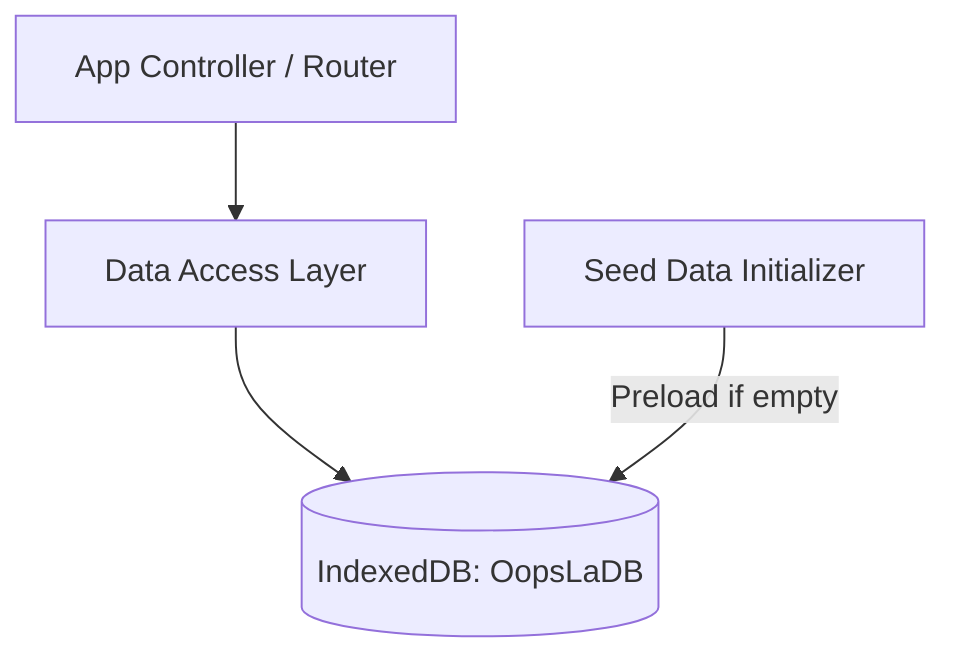

# Phase 1: Core Architecture & Storage Foundations

## Overview
Establish the project foundation, domain type schemas, and the IndexedDB persistence layer (`OopsLaDB`) for local asset management, catalog cache, order tracking, and editorial articles.

## Requirements
- **Functional**:
  - Define domain interfaces: `Book`, `MediaAsset` (Front, Back, Spine, Spread), `Order`, `OrderItem`, `CustomerInfo`, `EditorialArticle`, `UserRole` (`OWNER` | `STAFF`), `OrderStatus` (`PENDING_CONTACT` | `CONTACTED` | `CONFIRMED` | `CANCELLED`).
  - Implement IndexedDB wrapper with object stores: `books`, `media_assets`, `orders`, `articles`, `settings`.
  - Provide seed data containing Atelier Bow-Wow Graphic Anatomy, Spatial Monograph, Sumo Edition Taschen, and introductory editorial essays.
- **Non-functional**:
  - Zero external database dependencies required for standalone client operation.
  - Fail-safe schema upgrades with versioning.
  - Strict compliance with TypeScript/ES module conventions.

## Architecture

## Related Code Files
- Create: `src/types/domain.ts`
- Create: `src/storage/indexed-db.ts`
- Create: `src/data/seed-data.ts`
- Create: `src/services/catalogService.ts`

## Implementation Steps
1. Define strict domain types in `src/types/domain.ts` reflecting BRD-OLS-002 and cookbook contracts.
2. Build `IndexedDBAdapter` in `src/storage/indexed-db.ts` managing binary blobs (images/drawings) and JSON records.
3. Formulate architectural seed catalog in `src/data/seed-data.ts` with Atelier Bow-Wow 1:20 drawing entries, SUMO dimensions, and VNĐ pricing.
4. Create data access repositories for books, orders, and articles with automated fallback to seed data.

## Success Criteria
- [x] IndexedDB initializes cleanly in browser environments with all 5 object stores.
- [x] Seed data populates automatically on first run without duplicate key errors.
- [x] Media assets can be stored as Blob/ArrayBuffer and retrieved as ObjectURLs.
- [x] Domain models prevent arbitrary mutation of read-only attributes.

## Risk Assessment
- *Risk*: IndexedDB quota limitations on large architectural drawing high-res blobs.
- *Mitigation*: Compress preview blobs while storing raw spreads within standard browser quota (~50MB+ available per origin).
