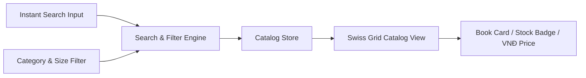

# Phase 2: Storefront Catalog & Instant Search

## Overview
Implement the public editorial storefront featuring the Atelier Bow-Wow Hero Showcase, Editorial Journal essays, Swiss Grid catalog layout with zero-border-radius design tokens, instant multi-attribute search, and strict single-currency VNĐ formatting.

## Requirements
- **Functional**:
  - Hero Showcase dedicated to Atelier Bow-Wow architectural monographs and technical drawings.
  - Editorial Journal feed showing published architectural critiques and monograph deep-dives.
  - Catalog filtering by Category (Monograph, Technical Drawings, Urban Theory) and Book Size (`STANDARD`, `SUMO`, `XXL`).
  - Real-time search across Title, Author, and ISBN with zero latency.
  - Price formatting strictly in `VNĐ` (e.g. `250.000 VNĐ`, `18.500.000 VNĐ`), rounded to tens of thousands; no USD switcher (CURR-01).
  - Dynamic stock badges: `IN_STOCK`, `ONE_COPY_LEFT` (when stock = 1), `SOLD_OUT` (when stock = 0).
- **Non-functional**:
  - Strict Swiss Grid aesthetics: zero rounded corners (`border-radius: 0px !important`).
  - Colors matching design tokens: `taschenRed` (#E30613), `taschenGold` (#C5A059), `galleryBg` (#F8F8F6), `inkBlack` (#111111), `gridLine` (#E5E5E5), `bowwowBlue` (#0080C6).
  - Mobile-responsive layout without horizontal scrolling.

## Architecture

## Related Code Files
- Create: `src/components/storefront/HeroShowcase.ts`
- Create: `src/components/storefront/EditorialJournal.ts`
- Create: `src/components/storefront/CatalogGrid.ts`
- Create: `src/components/storefront/SearchAndFilter.ts`
- Create: `src/utils/currencyFormatter.ts`

## Implementation Steps
1. Create `currencyFormatter.ts` providing immutable VNĐ formatting with thousands separators and zero decimal places.
2. Build `HeroShowcase.ts` rendering the editorial narrative and featured works of Atelier Bow-Wow.
3. Build `EditorialJournal.ts` displaying architectural articles linked to catalog items.
4. Construct `SearchAndFilter.ts` supporting instant debounced search on ISBN, Author, and Title combined with size/category pills.
5. Implement `CatalogGrid.ts` rendering books with precise status badges (`IN_STOCK`, `ONE_COPY_LEFT`, `SOLD_OUT`).

## Success Criteria
- [x] Entering an ISBN, author, or partial title updates the catalog instantaneously.
- [x] Filtering by SUMO/XXL shows only oversized collector editions.
- [x] Every price on storefront displays in `... VNĐ` with no USD toggle or foreign currency references.
- [x] A book with stock = 0 clearly displays `SOLD_OUT` and disables the add-to-bag trigger.

## Risk Assessment
- *Risk*: Slow search filtering with large book datasets.
- *Mitigation*: In-memory normalized index for instantaneous sub-millisecond filtering on client-side catalog.
