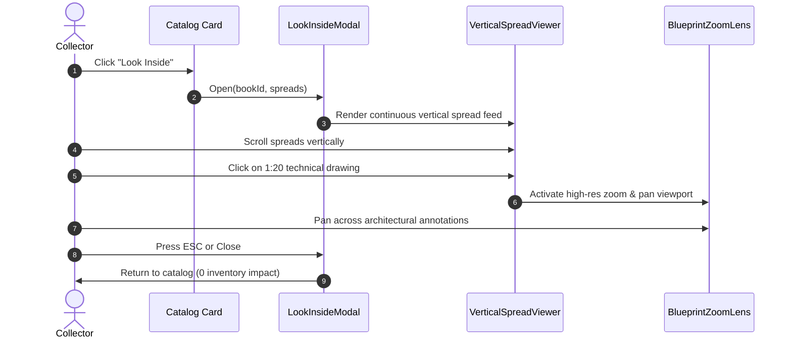

# Phase 3: Look Inside Viewer & 1:20 Blueprint Zoom

## Overview
Develop the signature "Look Inside" continuous vertical spread inspection modal and the high-resolution Blueprint Zoom tool (1:20 scale) tailored for Atelier Bow-Wow architectural drawings.

## Requirements
- **Functional**:
  - Modal overlay activated by clicking "Look Inside" on any monograph or catalog item.
  - Continuous vertical scroll rendering all interior spreads sequentially.
  - Interactive Blueprint Zoom allowing collectors to inspect fine cross-sections, annotations, and 1:20 scale line weights without visual degradation.
  - Pan navigation and magnification toggle (1x, 2x, 4x / 1:20 detail).
  - Keyboard accessibility (ESC to close, +/- to zoom, Arrow keys to navigate) and backdrop dismissal.
  - Viewing spreads must never lock, reserve, or decrement inventory.
- **Non-functional**:
  - Smooth 60fps scrolling and panning performance.
  - Lazy loading of off-screen spread images to conserve bandwidth and memory.
  - Clean typographic attribution (Project title, scale indicator, spread page numbers).

## Architecture

## Related Code Files
- Create: `src/components/viewer/LookInsideModal.ts`
- Create: `src/components/viewer/VerticalSpreadViewer.ts`
- Create: `src/components/viewer/BlueprintZoomLens.ts`
- Modify: `src/components/storefront/CatalogGrid.ts` (attach viewer trigger)

## Implementation Steps
1. Build `LookInsideModal.ts` with modal container, header showing monograph specs, and close controls.
2. Build `VerticalSpreadViewer.ts` managing the sequence of front cover, endpapers, spreads, and back cover.
3. Build `BlueprintZoomLens.ts` with transform-origin calculation, pan dragging, and wheel zoom handling.
4. Integrate high-resolution image loading from IndexedDB and bundled assets.
5. Add keyboard shortcuts and mobile touch-pinch support for responsive inspection.

## Success Criteria
- [x] Clicking "Look Inside" launches the modal smoothly without layout shift.
- [x] Spreads flow continuously in a single vertical column.
- [x] Blueprint zoom allows magnifying Atelier Bow-Wow 1:20 architectural details clearly.
- [x] Zero changes to stock or basket state during the entire viewing session.

## Risk Assessment
- *Risk*: High-resolution architectural drawings consuming substantial GPU/DOM memory during zoom.
- *Mitigation*: CSS hardware-accelerated transforms (`transform: translate3d(...) scale(...)`) and unload off-screen spreads.
