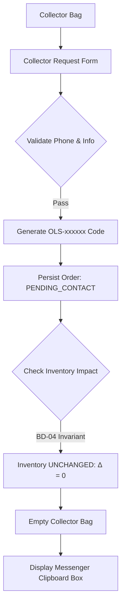

# Phase 4: Collector Request Flow & Messenger Export

## Overview
Implement the Collector Bag (Túi yêu cầu mua) and checkout request workflow, enforcing the core business invariant of **Zero Auto-Reservation (BD-04)** and providing a standardized Facebook Messenger clipboard copy format.

## Requirements
- **Functional**:
  - Collector Bag drawer/modal showing chosen monographs, unit prices in VNĐ, quantity modifiers, and subtotal.
  - Collector Request Form collecting: Full Name, Phone Number (Vietnamese format validation), Shipping Address, and Optional Notes.
  - Order ID generator yielding unique alphanumeric codes prefixed with `OLS-` (e.g. `OLS-261104-9841`).
  - **Zero Auto-Reservation (BD-04)**: Submitting the request creates an order with status `PENDING_CONTACT` but DOES NOT lock or decrement book inventory.
  - Messenger Export Box: Formats a structured message with order code, buyer details, monograph items, total price, and instructions; includes a 1-click "Sao chép tin nhắn Messenger" button.
  - Automatically clear the Collector Bag upon request submission.
- **Non-functional**:
  - Clear user guidance explaining that books are hand-inspected and confirmed by the bookstore staff via Messenger before payment.
  - Resilient clipboard API integration with fallback textarea copy.

## Architecture

## Related Code Files
- Create: `src/components/checkout/CollectorBag.ts`
- Create: `src/components/checkout/CollectorRequestForm.ts`
- Create: `src/components/checkout/MessengerExportModal.ts`
- Create: `src/services/orderService.ts`
- Create: `src/utils/idGenerator.ts`

## Implementation Steps
1. Create `idGenerator.ts` to output compliant `OLS-xxxxxx` identifiers with timestamp entropy.
2. Build `CollectorBag.ts` state manager to track monographs added by the reader without reserving inventory.
3. Build `CollectorRequestForm.ts` with phone validation and clean editorial styling.
4. Implement `orderService.ts` to persist new orders in IndexedDB with status `PENDING_CONTACT` and `REQUEST_SOURCE: website`.
5. Implement `MessengerExportModal.ts` displaying formatted Vietnamese order summary with a high-visibility copy button and direct link to m.me/tiemsach.

## Success Criteria
- [x] Submitting a request creates a valid `OLS-xxxxxx` order stored in `OopsLaDB`.
- [x] Submitting a request empties the Collector Bag.
- [x] **Crucial Invariant Check**: Book stock count in catalog remains completely identical before and after submitting the request (Zero Auto-Reservation).
- [x] Clicking "Sao chép tin nhắn" successfully writes formatted order text to system clipboard.

## Risk Assessment
- *Risk*: Users assuming that placing a request immediately secures the rare monograph.
- *Mitigation*: Prominently display editorial notice: "Đơn hàng chỉ được xác nhận chính thức sau khi tiệm gửi ảnh kiểm tra thực tế và đối soát cọc qua Messenger."
