# Phase 5: Admin CMS & Dual-Role Permission Engine

## Overview
Build the internal Admin CMS, incorporating the Dual-Role switcher (`Owner` vs. `Staff`), book inventory and spread media management, editorial article publisher, and strict order status state transitions enforcing `OD-01`, `OD-02`, `OD-03 Option B`, `AC-11`, and `AC-15`.

## Requirements
- **Functional**:
  - Dual-Role Switcher on Admin Header clearly displaying current role: `Owner (Chủ tiệm)` or `Staff (Nhân viên)`.
  - Book & Media Management:
    - CRUD book details (Title, Author, ISBN, Dimensions, Price in VNĐ, Stock Count).
    - Manage Media assets in IndexedDB categorized as Front, Back, Spine, and Spread.
    - Quick inventory update button when items are sold directly at bookstore / on Facebook.
  - Editorial Journal Management: Draft, edit, preview, and publish architectural articles with links to catalog monographs.
  - Order Management & Strict State Machine:
    - Status Pipeline: `PENDING_CONTACT` -> `CONTACTED` -> `CONFIRMED` -> `CANCELLED`.
    - **AC-11 (Staff Restriction)**: When user is `Staff`, the `CONFIRMED` transition action is disabled with label `(Chỉ Owner)`.
    - **OD-01 (Cancellation Guard)**: Both `Staff` and `Owner` can cancel unconfirmed orders (`PENDING_CONTACT` or `CONTACTED`); once an order is `CONFIRMED`, `Staff` is blocked from cancelling (only `Owner` may cancel).
    - **OD-02 (Stock Verification Guard)**: When `Owner` attempts to set status `CONFIRMED`, system verifies if available stock $\ge \text{quantity}$. If stock $= 0$, action is strictly blocked with modal dialog `Cảnh báo OD-02: Không thể duyệt đơn khi tồn kho = 0`.
    - **AC-15 (Single Decrement)**: Transitioning an order to `CONFIRMED` decrements book inventory by item quantity exactly once.
    - **OD-03 Option B (Offline Refund)**: No online refund button in CMS; show offline note for manual bank return.
    - **48-Hour Stale Alert**: Orders remaining in `PENDING_CONTACT` created $>48$ hours ago display amber badge `⚠️ QUÁ 48H CHỜ CỌC`.
- **Non-functional**:
  - Fail-closed permission enforcement (server/service level guard, not merely visual client hiding).
  - Clear audit trail timestamping status changes and acting user role.

## Architecture

```mermaid
stateDiagram-v2
    [*] --> PENDING_CONTACT: Website Customer Request
    
    PENDING_CONTACT --> CONTACTED: Staff or Owner contacts buyer
    PENDING_CONTACT --> CANCELLED: Staff or Owner cancels (OD-01)
    
    CONTACTED --> CANCELLED: Staff or Owner cancels (OD-01)
    CONTACTED --> CONFIRMED: Owner ONLY (AC-11) & Stock >= 1 (OD-02)
    
    state CONFIRMED {
        [*] --> SingleInventoryDecrement: Decrement stock exactly once (AC-15)
    }
    
    CONFIRMED --> CANCELLED: Owner ONLY (OD-01); Staff BLOCKED
```

## Related Code Files
- Create: `src/components/admin/AdminLayout.ts`
- Create: `src/components/admin/DualRoleSwitcher.ts`
- Create: `src/components/admin/BookInventoryManager.ts`
- Create: `src/components/admin/MediaAssetManager.ts`
- Create: `src/components/admin/EditorialArticleManager.ts`
- Create: `src/components/admin/OrderWorkflowTable.ts`
- Create: `src/services/permissionGuard.ts`

## Implementation Steps
1. Implement `permissionGuard.ts` checking role-based capabilities (`canConfirmOrder`, `canCancelOrder`) according to `auth-roles.workbook.md`.
2. Construct `DualRoleSwitcher.ts` persisting active session role in local state.
3. Build `BookInventoryManager.ts` and `MediaAssetManager.ts` allowing image uploads to IndexedDB and live stock adjustment.
4. Build `EditorialArticleManager.ts` for composing architectural critiques.
5. Implement `OrderWorkflowTable.ts` with status filter tabs, 48h stale badge calculation, and guarded action buttons.
6. Wire OD-02 stock check modal and AC-15 atomic inventory decrement inside order transition handler.

## Success Criteria
- [x] Switching between Owner and Staff updates UI capability states immediately.
- [x] In Staff mode, the dropdown/button for `CONFIRMED` is disabled with text `(Chỉ Owner)`.
- [x] In Staff mode, clicking Cancel on a `CONFIRMED` order is blocked.
- [x] In Owner mode, clicking `CONFIRMED` on a book with stock = 0 triggers the OD-02 blocker popup.
- [x] In Owner mode, clicking `CONFIRMED` on a book with stock $\ge 1$ succeeds and drops stock count by the ordered amount.
- [x] Orders older than 48 hours in `PENDING_CONTACT` show `⚠️ QUÁ 48H CHỜ CỌC`.

## Risk Assessment
- *Risk*: Staff modifying client-side DOM to enable the disabled `CONFIRMED` button.
- *Mitigation*: The `permissionGuard` service must validate the active role and reject the transition at the business logic layer, throwing an authorization error regardless of UI state.
