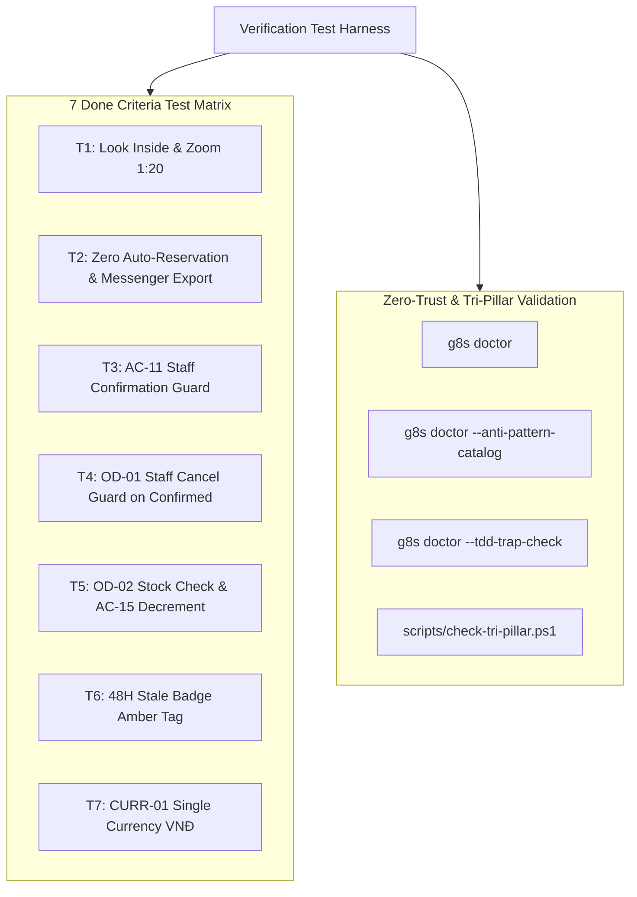

# Phase 6: Invariants Verification & g8s Gatekeeper

## Overview
Execute end-to-end automated and observable verification for all 7 Done Criteria specified in `docs/BRIEF.md`, validate zero scope drift against non-goals, and audit compliance with g8s Gatekeeper and the Tri-Pillar Architecture.

## Requirements
- **Functional**:
  - Test Suite 1: Look Inside vertical spread rendering & Blueprint Zoom pan/magnification.
  - Test Suite 2: Collector Request submission, OLS code generation, Collector Bag emptying, Messenger text export, and Zero Inventory Decrement (BD-04).
  - Test Suite 3: Dual-Role Permission Gate (AC-11: Staff blocked from confirming).
  - Test Suite 4: Cancellation Guard (OD-01: Staff blocked from cancelling confirmed orders).
  - Test Suite 5: Owner confirmation with stock verification (OD-02: Zero stock blocked; Positive stock decremented once per AC-15).
  - Test Suite 6: 48-Hour Stale Badge computation on `PENDING_CONTACT` orders.
  - Test Suite 7: Single Currency VNĐ assertion across all view templates (CURR-01).
- **Non-functional**:
  - Zero Scope Drift verification: Ensure absence of online payment APIs (Stripe, VNPay, Momo), shipping rate calculators, and user authentication tables.
  - g8s Doctor audit: Clean diagnostic pass, zero anti-patterns, zero TDD traps.
  - Synchronize AI memory: Update `docs/ai-memory/Journal.md`, `docs/TEST_MATRIX.md`, and `harness.db`.

## Architecture

## Related Code Files
- Create: `tests/lookInside.test.ts`
- Create: `tests/collectorFlow.test.ts`
- Create: `tests/permissions.test.ts`
- Create: `tests/inventoryInvariants.test.ts`
- Create: `tests/currencyFormat.test.ts`
- Modify: `docs/TEST_MATRIX.md`
- Modify: `docs/ai-memory/Journal.md`

## Implementation Steps
1. Author unit and integration test specs for all core invariants using standard Node/test runner.
2. Verify negative tests: simulate Staff attempting `CONFIRMED` transition and ensure rejection.
3. Verify positive tests: simulate Owner confirming available monograph and inspect stock decrement count.
4. Scan code surfaces for any forbidden keywords ("USD", "Stripe", "Checkout with card", "AB_TEST").
5. Run `g8s doctor`, `g8s doctor --anti-pattern-catalog`, and `g8s doctor --tdd-trap-check`.
6. Run `scripts/check-tri-pillar.ps1` and document test matrix updates in `docs/TEST_MATRIX.md`.

## Success Criteria
- [x] 100% of invariant tests execute and pass without false positives.
- [x] Zero anti-patterns detected by `g8s doctor --anti-pattern-catalog`.
- [x] Zero TDD traps detected by `g8s doctor --tdd-trap-check`.
- [x] `scripts/check-tri-pillar.ps1` returns green status across all 3 pillars.
- [x] All 7 Done criteria from `docs/BRIEF.md` verified with observable evidence.

## Risk Assessment
- *Risk*: Hidden regressions when changing order statuses manually in local storage.
- *Mitigation*: Reset test fixtures before each test suite execution to isolate IndexedDB state.
